
<a href="README.md">English</a> | <a href="README.zh-CN.md">简体中文</a> | <a href="README.zh-TW.md">繁體中文（台灣）</a> | <a href="README.zh-HK.md">繁體中文（香港）</a> | <strong>日本語</strong> | <a href="README.ko.md">한국어</a>

# JPX-PLUS

HentaiVerse 向けの JPX 拡張ユーザースクリプトです。複数の設定を管理し、戦闘ルールを編集・共有できます。戦闘統計は PC でもスマホでも確認できます。

**JPX の原作者である[闯关弟子](https://forums.e-hentai.org/index.php?showuser=4802944)さんに、心から感謝します。** JPX-PLUS は、その成果を土台にしたプロジェクトです。JPX を作り、公開してくださったことが、このプロジェクトの出発点です。

**[JPX-PLUS をインストール](https://raw.githubusercontent.com/MeiYongAI/JPX-PLUS/main/JPX-PLUS.user.js)** · **[プレビューを試す](https://meiyongai.github.io/JPX-PLUS/?lang=en&page=configs)** · [更新履歴](CHANGELOG.md)

**2026.11.13.1：** 補助と攻撃を1つのルール一覧に統合し、通常攻撃にも条件を設定できます。挿入メニューの切り替えで位置がずれなくなりました。更新前に設定をバックアップしてください。旧設定は読み込み時に変換され、保存後は旧バージョンで読み込めない新形式になります。[更新ガイド](docs/upgrading.md)。

## インストール

1. ユーザースクリプト管理拡張で JPX-PLUS をインストールし、HentaiVerse を再読み込みします。
2. 本体の表示言語は英語です。ほかの言語を使う場合は、本体に加えて言語パックを**1つだけ**有効にしてください。

[简体中文](https://raw.githubusercontent.com/MeiYongAI/JPX-PLUS/main/JPX-PLUS-ZhCN.user.js) · [繁體中文（台灣）](https://raw.githubusercontent.com/MeiYongAI/JPX-PLUS/main/JPX-PLUS-ZhTW.user.js) · [繁體中文（香港）](https://raw.githubusercontent.com/MeiYongAI/JPX-PLUS/main/JPX-PLUS-ZhHK.user.js) · [日本語](https://raw.githubusercontent.com/MeiYongAI/JPX-PLUS/main/JPX-PLUS-Ja.user.js) · [한국어](https://raw.githubusercontent.com/MeiYongAI/JPX-PLUS/main/JPX-PLUS-Ko.user.js)

本体と言語パックは一緒に更新してください。GitHub の更新 URL を設定済みです。更新の自動チェックは、お使いのスクリプト管理拡張の設定に従います。

**設定管理とストアは本体に含まれています。** ストア用の追加インストールは不要です。元の JPX から移行する方は、[移行ガイド（英語・中国語）](docs/upgrading.md)をご覧ください。

**モンスター情報は本体に内蔵されています。** 基本設定で**種族・攻撃タイプ・戦闘力を表示**を有効にして保存してください。別のデータベーススクリプトは不要です。データは [Sukka Monster Database](https://hv-monster.skk.moe/)を使用します。[キャッシュと互換性](docs/monster-database.md)。

**メインサイトと alt でデータを共有します。** 同じスクリプトの設定、完了した戦闘の記録、日ごとのスタミナを共有します。更新後、戦闘中でない状態で両サイトを一度ずつ開いてください。以前のデータは統計画面のデータ管理から復元できます。[移行の詳細](docs/alt-shared-data-2026-11-08.md)。

## 設定管理

同じスタイル・戦闘・ワールド向けの設定を、複数保存できます。**マイ設定**で保存、名前の変更、絞り込み、並べ替えを行い、**編集**から専用のルール編集画面を開きます。

**戦闘別の戦略**で、ワールド・スタイル・戦闘ごとにルールを割り当てます。個別指定がなければ共通ルールを継承します。固定ルールを解除するには**自動選択に戻す**を選びます。[選択の仕組み](docs/scene-strategies.md) · [戦闘別の戦略をプレビュー](https://meiyongai.github.io/JPX-PLUS/?lang=en&page=scenes)。

<table>
<tr><th width="50%">マイ設定</th><th width="50%">ルール編集</th></tr>
<tr><td valign="top"><a href="https://meiyongai.github.io/JPX-PLUS/?lang=en&amp;page=configs&amp;device=desktop"><picture><source media="(prefers-color-scheme: dark)" srcset="docs/images/desktop-configs-dark-en.png">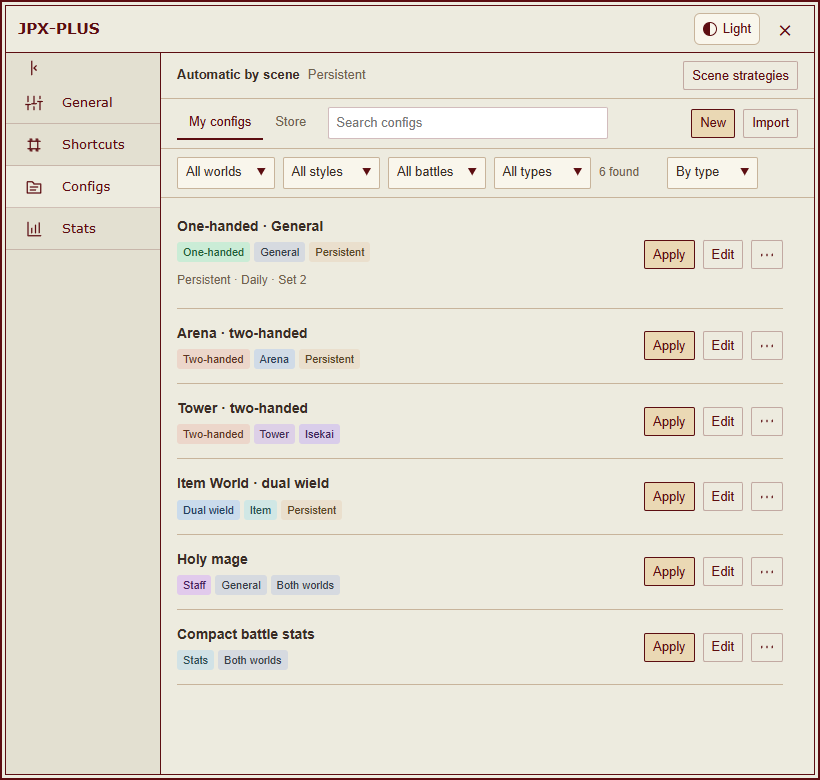</picture></a></td><td valign="top"><a href="https://meiyongai.github.io/JPX-PLUS/?lang=en&amp;page=rules&amp;device=desktop"><picture><source media="(prefers-color-scheme: dark)" srcset="docs/images/desktop-rules-dark-en.png">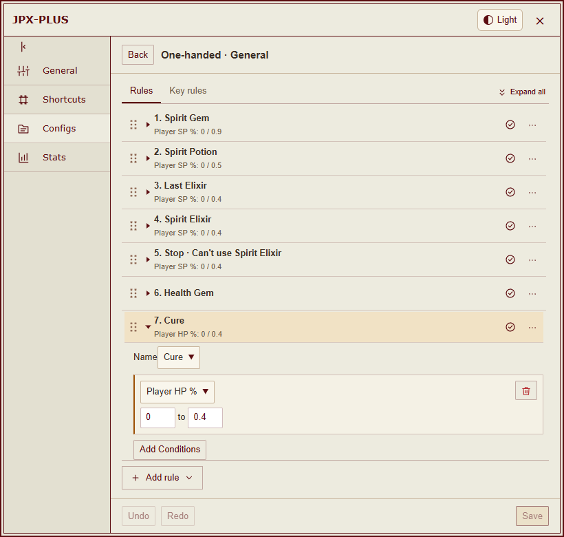</picture></a></td></tr>
</table>

- **適用**を押すと、選んだルールがすぐに使われます。**使用中**は適用済みの設定、**現在のスタイル**は装備から判定したスタイルを示します。戦闘中に適用すると、自動操作は一時停止します。
- 編集画面の**保存**は、保存済みの設定を更新するだけです。変更をすぐに使うには、**更新して適用**を選んでください。
- **その他**メニューから、設定を特定のワールド・ペルソナ・装備セットに連携できます。その組み合わせに切り替えると、保存したルールが適用されます。1つの設定を複数のセットに連携でき、連携のないセットでは現在のルールを引き続き使います。
- 設定内のルールグループから、スタイル・ワールド・戦闘タイプ・属性の色付きタグを表示します。ライト・ダーク両テーマに対応。ワールド、スタイル、戦闘、タイプで絞り込めるほか、名前やタグでも検索できます。タイプ順、更新順、名前順、ドラッグでの手動並べ替えに対応しています。
- **その他 → 削除**で使用先を確認し、**連携を解除して削除**を選ぶと連携と保存済みの設定を削除できます。
- 元の JPX の設定ファイルも読み込めます。書き出しは**使用中**・**設定一式**・**ルールを選ぶ**の3通り。戦闘ごとの割り当ては PLUS の設定ライブラリに保存され、元の JPX 形式の書き出しには含まれません。

装備セットとの連携・ルールの書き出し

<table>
<tr><th width="50%">装備セットとの連携</th><th width="50%">ルールの書き出し</th></tr>
<tr><td valign="top"><a href="https://meiyongai.github.io/JPX-PLUS/?lang=en&amp;page=bindings&amp;device=desktop"><picture><source media="(prefers-color-scheme: dark)" srcset="docs/images/desktop-bindings-dark-en.png">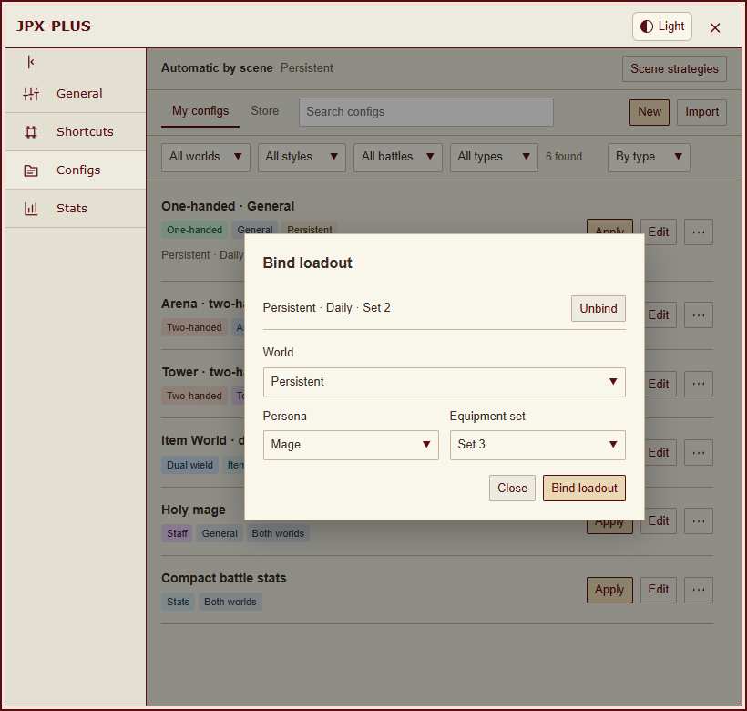</picture></a></td><td valign="top"><a href="https://meiyongai.github.io/JPX-PLUS/?lang=en&amp;page=export&amp;device=desktop"><picture><source media="(prefers-color-scheme: dark)" srcset="docs/images/desktop-export-dark-en.png">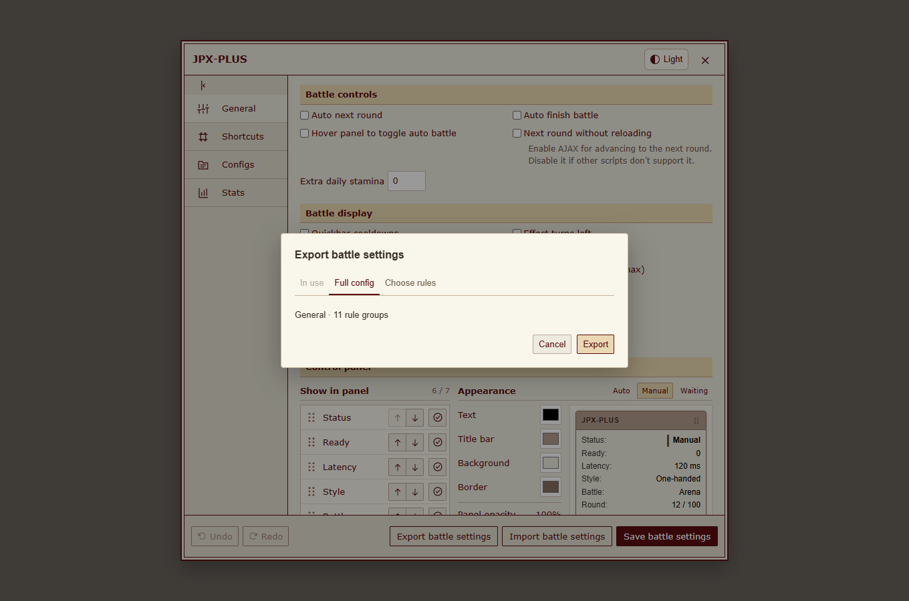</picture></a></td></tr>
</table>

### ストアと共有

閲覧とダウンロードにログインは不要です。ストアの設定を**マイ設定**に保存し、使いたいときに適用できます。GitHub でログインすると、保存した設定を共有し、**共有済み**で管理できます。

設定の詳細ページでコメントを読めます。GitHub にログインすると、自分のコメントを投稿・編集・削除できます。削除前に確認が表示されます。

コメントを書かずに星 1〜5 個で評価できます。1 つの設定につき GitHub アカウントごとに 1 票で、変更や取り消しも可能です。ストアには平均と評価数が表示されます。

ダウンロード数は保存の成功とファイルのダウンロード開始を数えます。同じブラウザーと設定では UTC の日付ごとに 1 回までで、ログインは不要です。匿名の識別子のみ送信し、GitHub のアカウント情報や設定内容は送りません。集計に失敗してもダウンロードは続けられます。

GitHub のログインは自動更新され、ログアウトには確認が必要です。旧版から更新した場合は、一度ログインし直す必要がある場合があります。[ログインの詳細](docs/store-authentication.md)。

<table>
<tr><th width="50%">ストア</th><th width="50%">共有済みの設定</th></tr>
<tr><td valign="top"><a href="https://meiyongai.github.io/JPX-PLUS/?lang=en&amp;page=store&amp;device=desktop"><picture><source media="(prefers-color-scheme: dark)" srcset="docs/images/desktop-store-dark-en.png">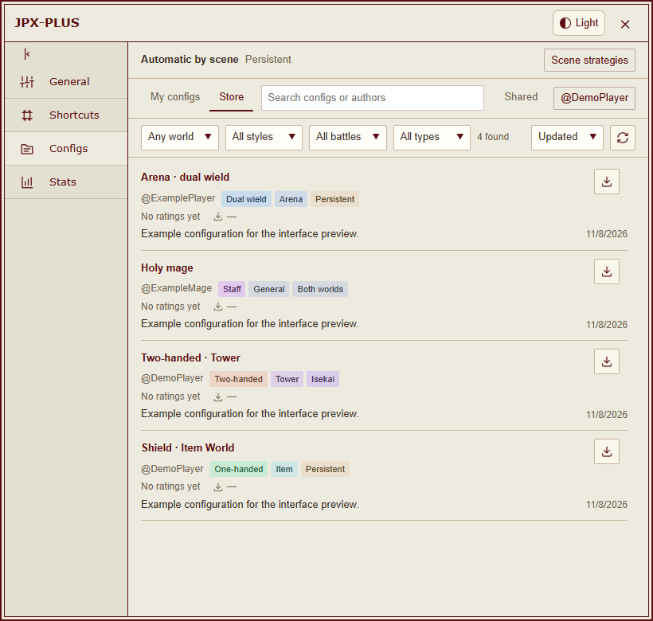</picture></a></td><td valign="top"><a href="https://meiyongai.github.io/JPX-PLUS/?lang=en&amp;page=shared&amp;device=desktop"><picture><source media="(prefers-color-scheme: dark)" srcset="docs/images/desktop-shared-dark-en.png">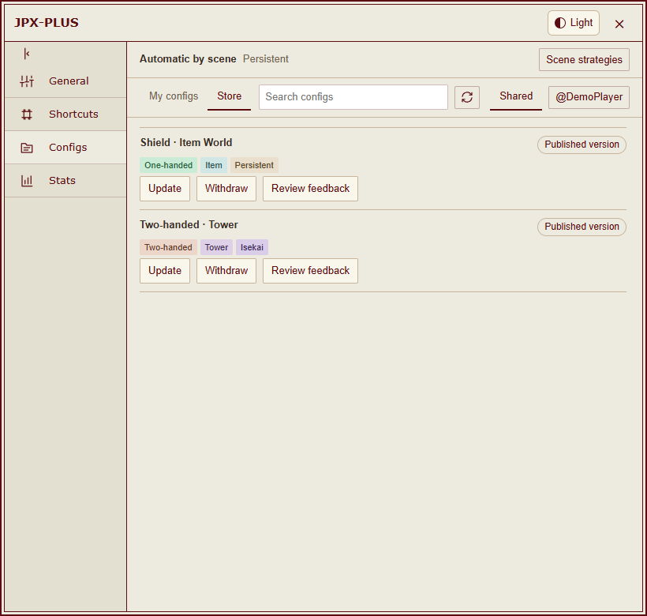</picture></a></td></tr>
</table>

共有した設定は、同じ掲載ページで更新、審査結果の確認、公開の取り下げができます。取り下げ済みの投稿は自分の一覧から削除できます。更新の審査中も、前回の承認済みバージョンは公開されたままです。共有内容を更新しても、ほかのプレイヤーが保存した設定を勝手に上書きすることはありません。

投稿内容は GitHub で公開されます。審査対象は形式と端末・データの安全性で、戦闘戦略の良し悪しは評価しません。コードや不審な内容は、AI による安全性の確認とメンテナーの承認が必要です。[審査方針（英語）](https://github.com/MeiYongAI/JPX-PLUS-Configs#how-sharing-works)。

## 画面プレビュー

[**ライトテーマ**](https://meiyongai.github.io/JPX-PLUS/?lang=en&theme=light&page=configs) · [**ダークテーマ**](https://meiyongai.github.io/JPX-PLUS/?lang=en&theme=dark&page=configs) · [PC・スマホのプレビュー](https://meiyongai.github.io/JPX-PLUS/?lang=en&page=configs)

同じ画面を、テーマ・言語・端末を切り替えて比較できます。スクリーンショットは実際のスクリプト UI にオフラインのサンプルデータを表示したものです。この README の画像は英語版で、プレビューは現在、英語と簡体字中国語に対応しています。

<table>
<tr><th width="50%">マイ設定</th><th width="50%">ストア</th></tr>
<tr><td valign="top"><a href="https://meiyongai.github.io/JPX-PLUS/?lang=en&amp;page=configs&amp;device=mobile"><picture><source media="(prefers-color-scheme: dark)" srcset="docs/images/mobile-configs-dark-en.png">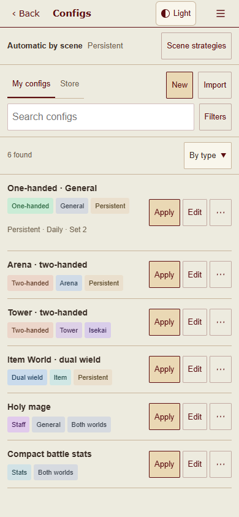</picture></a></td><td valign="top"><a href="https://meiyongai.github.io/JPX-PLUS/?lang=en&amp;page=store&amp;device=mobile"><picture><source media="(prefers-color-scheme: dark)" srcset="docs/images/mobile-store-dark-en.png">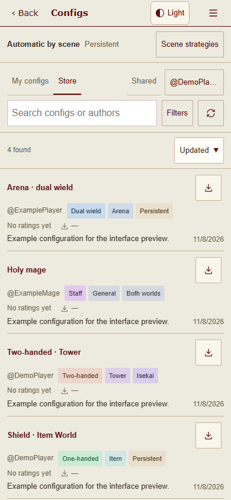</picture></a></td></tr>
</table>

スマホでは検索欄の横から絞り込みを開けます。各項目の操作はコンパクトにまとめ、設定画面の戻るボタンは1つだけにしています。HVUT の歯車メニューから設定と統計を開けます。歯車メニューがないタッチ端末では、JPX-PLUS のフローティングボタンを使えます。

設定・統計・戦闘結果

<table>
<tr><th width="50%">基本設定</th><th width="50%">統計の配色</th></tr>
<tr><td valign="top"><a href="https://meiyongai.github.io/JPX-PLUS/?lang=en&amp;page=settings&amp;device=desktop"><picture><source media="(prefers-color-scheme: dark)" srcset="docs/images/desktop-settings-dark-en.png">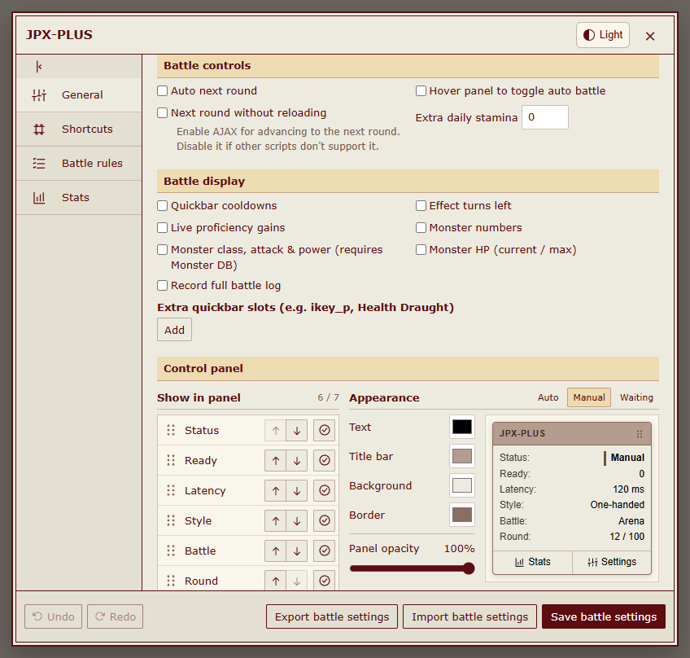</picture></a></td><td valign="top"><a href="https://meiyongai.github.io/JPX-PLUS/?lang=en&amp;page=colors&amp;device=desktop"><picture><source media="(prefers-color-scheme: dark)" srcset="docs/images/desktop-stats-settings-dark-en.png">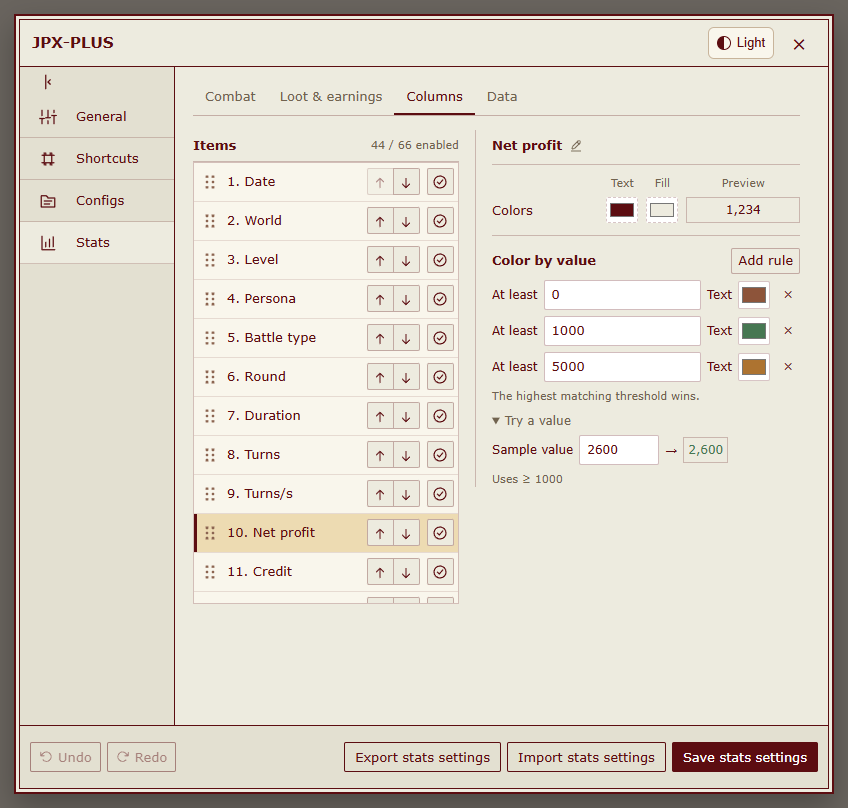</picture></a></td></tr>
</table>

<a href="https://meiyongai.github.io/JPX-PLUS/?lang=en&amp;page=records&amp;device=desktop"><picture><source media="(prefers-color-scheme: dark)" srcset="docs/images/desktop-records-dark-en.png">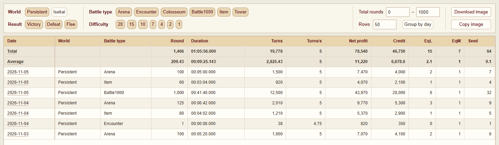</picture></a>

<table>
<tr><th width="50%">戦闘の詳細</th><th width="50%">戦闘結果</th></tr>
<tr><td valign="top"><a href="https://meiyongai.github.io/JPX-PLUS/?lang=en&amp;page=detail&amp;device=desktop"><picture><source media="(prefers-color-scheme: dark)" srcset="docs/images/desktop-detail-dark-en.png">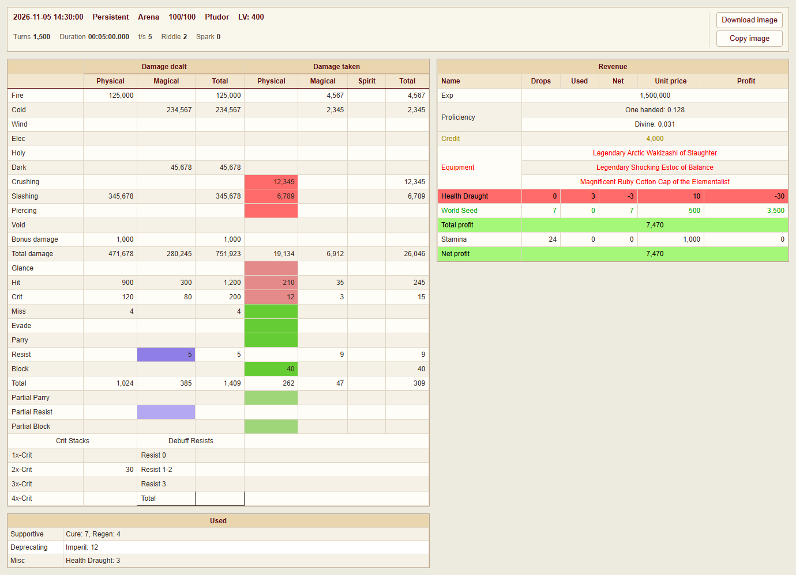</picture></a></td><td valign="top"><a href="https://meiyongai.github.io/JPX-PLUS/?lang=en&amp;page=final&amp;device=desktop"><picture><source media="(prefers-color-scheme: dark)" srcset="docs/images/desktop-final-dark-en.png">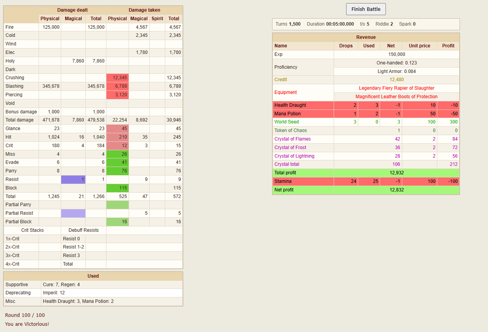</picture></a></td></tr>
</table>

<a href="https://meiyongai.github.io/JPX-PLUS/?lang=en&amp;page=panel&amp;device=desktop"><picture><source media="(prefers-color-scheme: dark)" srcset="docs/images/control-panel-dark-en.png">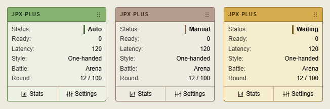</picture></a>

## 戦闘統計と操作

- 記録の絞り込み、1戦ごとの詳細確認、統計の画像コピー・ダウンロード。
- 記録画面のツールバーから、日別集計、絞り込み、表示項目、画像、記録の削除を操作できます。
- 表示項目は分類ごとに選択でき、変更は自動保存されてメインサイトと alt で共有されます。独自の名前・色・順序も維持します。
- 統計画面のデータ管理に、読み込み、書き出し、復元、範囲指定の削除をまとめています。削除前には確認が表示されます。
- ドラッグで移動できるパネルと統計の色を、プレビューを見ながら調整。ライト・ダークテーマにも対応。
- 戦闘ルール、条件、ショートカットを編集。「元に戻す」「やり直す」に対応。

| 初期キー | 操作 |
| --- | --- |
| <kbd>M</kbd> | 自動戦闘操作を開始・一時停止 |
| <kbd>,</kbd> | 設定を開く |
| <kbd>Z</kbd> | 戦闘統計を開く |

原作者が 2026 年 11 月 5 日に追加した両手武器の初期ルールを取り込んでいます。保存済みのルールは上書きされません。読み込むには、ルール編集画面で両手武器の設定を開き、**ルールをリセット**を使ってください。保存だけでは反映されないので、使用する際は適用も必要です。元の JPX と同じく、レベル 300 未満で有効になるセーフモードでも敗北を防げるとは限りません。

初期設定では戦闘結果画面を開いたままにします。**基本設定 → 戦闘操作 → 戦闘後に自動で戻る**を有効にすると、統計の保存後にゲームの終了ボタンを自動で押します。次の戦闘は開始しません。保存に失敗した場合は、結果画面を残します。

自動での戦闘開始、デイリーチェックイン、ロビーでのタスク予約は含まれていません。AJAX によるラウンド切り替え後に別のスクリプトが動かなくなる場合は、基本設定でこの機能を無効にしてください。AJAX 切り替えでは、ほかのユーザースクリプトは再読み込みされません。

## 関連ツール

| ツール | インストール | フォーラム |
| --- | --- | --- |
| HentaiVerse ダークテーマ · Stylus | [UserCSS](https://raw.githubusercontent.com/MeiYongAI/JPX-PLUS/main/HV-Dark.user.css) | [スレッド](https://forums.e-hentai.org/index.php?showtopic=302930) |
| E-Hentai フォーラム用ダークテーマ · Stylus | [UserCSS](https://raw.githubusercontent.com/MeiYongAI/JPX-PLUS/main/E-Hentai-Forums-Dark.user.css) | [スレッド](https://forums.e-hentai.org/index.php?showtopic=302931) |
| HentaiVerse 中国語翻訳 | [ユーザースクリプト](https://raw.githubusercontent.com/MeiYongAI/JPX-PLUS/main/HentaiVerse-Chinese.user.js) | [中国語スレッド](https://forums.e-hentai.org/index.php?showtopic=302932) |

これらは別途インストールするツールです。ゲーム本体の中国語翻訳と、JPX-PLUS の言語パックは別のものです。[スクリーンショット・導入方法・クレジット（英語）](docs/addons.md)。

## 不具合報告・開発

[Issues](https://github.com/MeiYongAI/JPX-PLUS/issues) は英語または中国語で受け付けています。スクリプトのバージョン、ブラウザ、ワールド、再現手順を添えてください。スクリーンショットや書き出した設定に、個人情報が含まれていないか確認してから送信してください。

開発については[ソースコード・ビルド・オフラインテスト（英語）](docs/development.md)をご覧ください。インストールするのは、単体で動く1本のユーザースクリプトです。開発用モジュールやテスト用パッケージはゲーム内で読み込まれません。
