
<a href="README.md">English</a> | <a href="README.zh-CN.md">简体中文</a> | <a href="README.zh-TW.md">繁體中文（台灣）</a> | <a href="README.zh-HK.md">繁體中文（香港）</a> | <a href="README.ja.md">日本語</a> | <strong>한국어</strong>

# JPX-PLUS

HentaiVerse용 JPX 확장 유저스크립트입니다. 여러 설정을 저장하고, 전투 규칙을 편집하거나 공유할 수 있습니다. PC와 모바일에서 전투 통계도 확인할 수 있습니다.

**원본 JPX를 만든 [闯关弟子](https://forums.e-hentai.org/index.php?showuser=4802944)님께 특별히 감사드립니다.** JPX-PLUS는 그 작업을 바탕으로 만들었습니다. JPX를 개발하고 공유해 주신 덕분에 이 프로젝트도 시작할 수 있었습니다.

**[JPX-PLUS 설치](https://raw.githubusercontent.com/MeiYongAI/JPX-PLUS/main/JPX-PLUS.user.js)** · **[미리보기](https://meiyongai.github.io/JPX-PLUS/?lang=en&page=configs)** · [변경 내역](CHANGELOG.md)

**2026.11.13.2:** 색상과 투명도를 개별 또는 한꺼번에 기본값으로 복원할 수 있습니다. 미리 보기와 실행 취소·다시 실행을 지원하며, 휴대폰에서도 누르기 편해졌습니다. 이전 버전에서 업데이트하기 전에 설정을 백업하세요. 기존 설정은 불러올 때 변환되며, 저장 후에는 JPX-PLUS 2026.11.13 이전 버전에서 읽을 수 없습니다. [업데이트 안내](docs/upgrading.md).

## 설치

1. 유저스크립트 관리 확장 프로그램에서 JPX-PLUS를 설치한 뒤 HentaiVerse를 새로고침합니다.
2. 기본 언어는 영어입니다. 다른 언어를 사용하려면 본체와 함께 언어 팩을 **하나만** 켜 주세요.

[简体中文](https://raw.githubusercontent.com/MeiYongAI/JPX-PLUS/main/JPX-PLUS-ZhCN.user.js) · [繁體中文（台灣）](https://raw.githubusercontent.com/MeiYongAI/JPX-PLUS/main/JPX-PLUS-ZhTW.user.js) · [繁體中文（香港）](https://raw.githubusercontent.com/MeiYongAI/JPX-PLUS/main/JPX-PLUS-ZhHK.user.js) · [日本語](https://raw.githubusercontent.com/MeiYongAI/JPX-PLUS/main/JPX-PLUS-Ja.user.js) · [한국어](https://raw.githubusercontent.com/MeiYongAI/JPX-PLUS/main/JPX-PLUS-Ko.user.js)

본체와 사용 중인 언어 팩을 함께 업데이트해 주세요. GitHub 업데이트 주소가 포함되어 있으며, 자동 확인은 유저스크립트 관리 확장 프로그램의 설정을 따릅니다.

**설정 관리와 스토어는 본체에 포함되어 있습니다.** 스토어를 따로 설치할 필요가 없습니다. 기존 JPX에서 옮겨 온다면 [이전 안내(영어·중국어)](docs/upgrading.md)를 참고해 주세요.

**몬스터 정보는 본체에 포함되어 있습니다.** 기본 설정에서 **몬스터 종족·공격 유형·전투력 표시**를 켜고 저장하세요. 별도 데이터베이스 스크립트는 필요 없습니다. 데이터는 [Sukka Monster Database](https://hv-monster.skk.moe/)에서 제공합니다. [캐시 및 호환성](docs/monster-database.md).

**메인 사이트와 alt가 데이터를 공유합니다.** 같은 스크립트 설치에서 설정, 완료한 전투 기록, 일일 스태미나를 공유합니다. 업데이트 후 전투 중이 아닐 때 두 사이트를 한 번씩 열어 주세요. 이전 데이터는 통계 화면의 데이터 관리에서 복원할 수 있습니다. [이전 안내](docs/alt-shared-data-2026-11-08.md).

## 설정 관리

같은 빌드·전투·월드용 설정도 여러 개 저장할 수 있습니다. **내 설정**에서 저장, 이름 변경, 필터링, 정렬을 하고, **편집**을 누르면 별도의 규칙 편집 화면이 열립니다.

**전투별 전략**에서 월드·빌드·전투별로 규칙을 지정합니다. 따로 지정하지 않으면 공통 규칙을 사용합니다. **자동 선택으로 돌아가기**를 선택하면 고정 규칙을 해제할 수 있습니다. [규칙 선택 안내](docs/scene-strategies.md). [전투별 전략 미리보기](https://meiyongai.github.io/JPX-PLUS/?lang=en&page=scenes).

<table>
<tr><th width="50%">내 설정</th><th width="50%">규칙 편집</th></tr>
<tr><td valign="top"><a href="https://meiyongai.github.io/JPX-PLUS/?lang=en&amp;page=configs&amp;device=desktop"><picture><source media="(prefers-color-scheme: dark)" srcset="docs/images/desktop-configs-dark-en.png">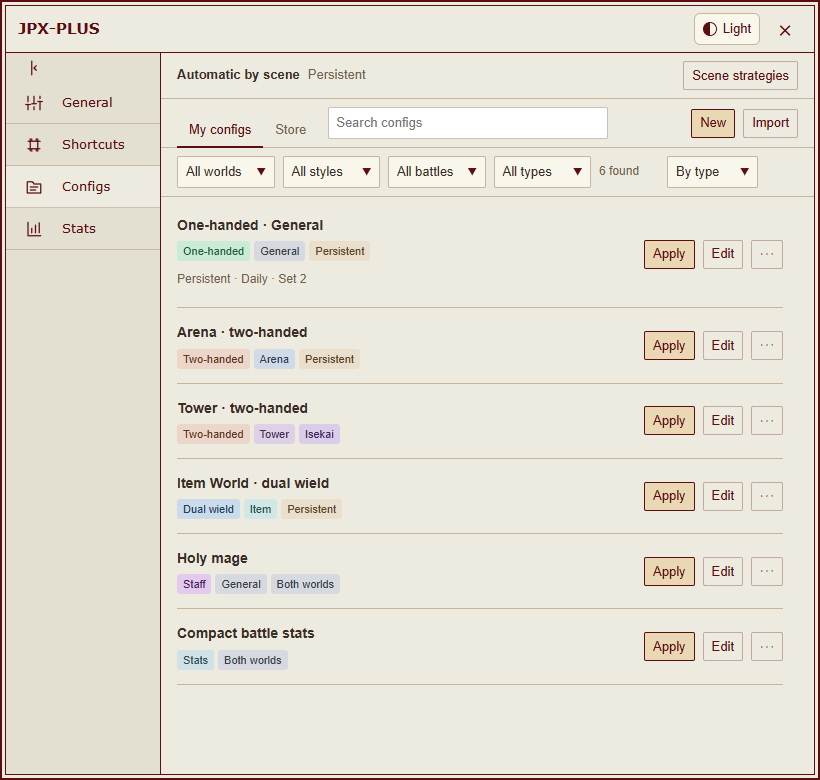</picture></a></td><td valign="top"><a href="https://meiyongai.github.io/JPX-PLUS/?lang=en&amp;page=rules&amp;device=desktop"><picture><source media="(prefers-color-scheme: dark)" srcset="docs/images/desktop-rules-dark-en.png">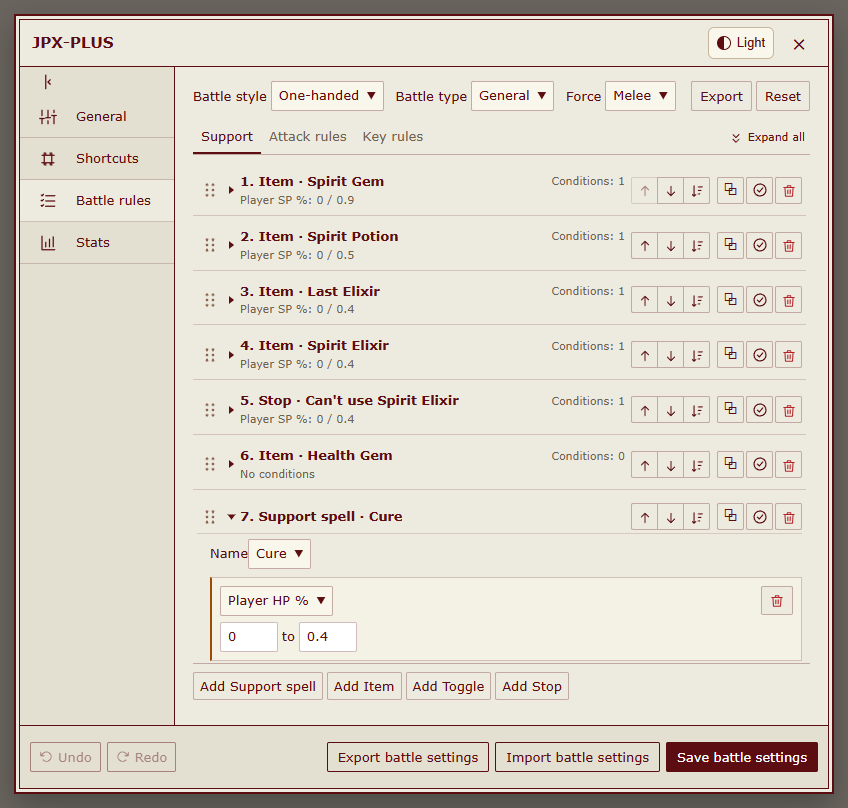</picture></a></td></tr>
</table>

- **적용**을 누르면 선택한 규칙을 바로 사용합니다. **사용 중**은 적용된 설정을, **현재 스타일**은 장비를 기준으로 판별한 빌드를 표시합니다. 전투 중 적용하면 자동 동작은 일시정지됩니다.
- 편집 화면의 **저장**은 저장된 사본만 갱신합니다. 수정한 규칙을 바로 사용하려면 **수정 후 적용**을 눌러 주세요.
- **더 보기** 메뉴에서 설정을 특정 월드의 페르소나·장비 세트에 연결할 수 있습니다. 해당 조합으로 바꾸면 저장된 규칙이 적용됩니다. 설정 하나를 여러 세트에 연결할 수 있으며, 연결되지 않은 세트에서는 현재 규칙을 그대로 사용합니다.
- 설정의 규칙 그룹을 바탕으로 빌드, 월드, 전투 유형, 속성을 색상 태그로 표시합니다. 밝은 테마와 어두운 테마 모두에 맞춰 표시됩니다. 월드·빌드·전투·유형으로 필터링하거나 이름과 태그로 검색할 수 있습니다. 유형순, 수정일순, 이름순 정렬과 드래그를 통한 직접 정렬을 지원합니다.
- **더 보기 → 삭제**에서 사용 중인 위치를 확인하고, **연결 해제 후 삭제**를 선택하면 연결과 저장된 설정을 삭제할 수 있습니다.
- 원본 JPX 설정 파일도 가져올 수 있습니다. 내보낼 때는 **사용 중**, **전체 설정**, **규칙 선택** 중에서 고르면 됩니다. 전투별로 지정한 규칙은 PLUS 설정 라이브러리에 저장되며 원본 JPX 형식으로 내보낼 때는 포함되지 않습니다.

장비 세트 연결·규칙 내보내기

<table>
<tr><th width="50%">장비 세트 연결</th><th width="50%">규칙 내보내기</th></tr>
<tr><td valign="top"><a href="https://meiyongai.github.io/JPX-PLUS/?lang=en&amp;page=bindings&amp;device=desktop"><picture><source media="(prefers-color-scheme: dark)" srcset="docs/images/desktop-bindings-dark-en.png">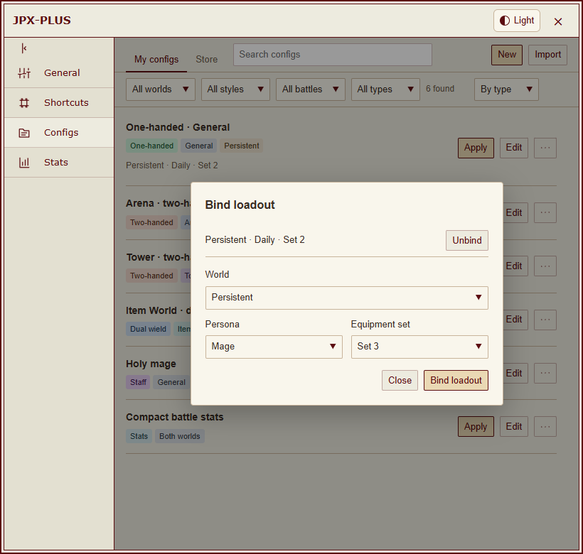</picture></a></td><td valign="top"><a href="https://meiyongai.github.io/JPX-PLUS/?lang=en&amp;page=export&amp;device=desktop"><picture><source media="(prefers-color-scheme: dark)" srcset="docs/images/desktop-export-dark-en.png">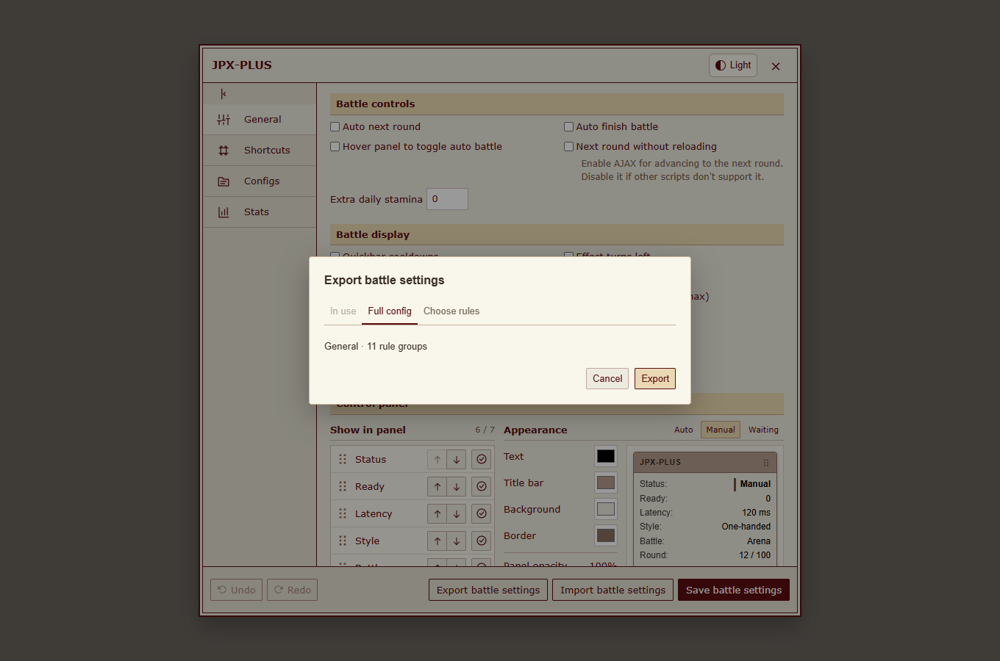</picture></a></td></tr>
</table>

### 스토어와 공유

로그인 없이 둘러보고 다운로드할 수 있습니다. 스토어의 설정을 **내 설정**에 저장한 뒤 원하는 때에 적용하세요. GitHub로 로그인하면 저장한 설정을 공유하고 **공유한 설정**에서 관리할 수 있습니다.

설정 상세 페이지에서 댓글을 볼 수 있습니다. GitHub에 로그인하면 댓글을 쓰고 내 댓글을 수정하거나 삭제할 수 있습니다. 삭제 전 확인 창이 표시됩니다.

댓글 없이 별 1~5개로 평가할 수 있습니다. 설정마다 GitHub 계정당 한 표만 반영되며 변경하거나 철회할 수 있습니다. 스토어에 평균 점수와 평가 인원이 표시됩니다.

다운로드 수에는 저장 성공과 파일 다운로드 시작이 포함됩니다. 같은 브라우저와 설정은 UTC 날짜별로 한 번만 집계하며 로그인이 필요 없습니다. 익명 식별자만 보내고 GitHub 계정 정보나 설정 내용은 보내지 않습니다. 집계가 실패해도 다운로드는 계속할 수 있습니다.

GitHub 로그인은 자동으로 갱신되며, 로그아웃 전에는 확인을 받습니다. 이전 버전에서 업데이트했다면 한 번 다시 로그인해야 할 수 있습니다. [로그인 안내](docs/store-authentication.md).

<table>
<tr><th width="50%">스토어</th><th width="50%">공유한 설정</th></tr>
<tr><td valign="top"><a href="https://meiyongai.github.io/JPX-PLUS/?lang=en&amp;page=store&amp;device=desktop"><picture><source media="(prefers-color-scheme: dark)" srcset="docs/images/desktop-store-dark-en.png">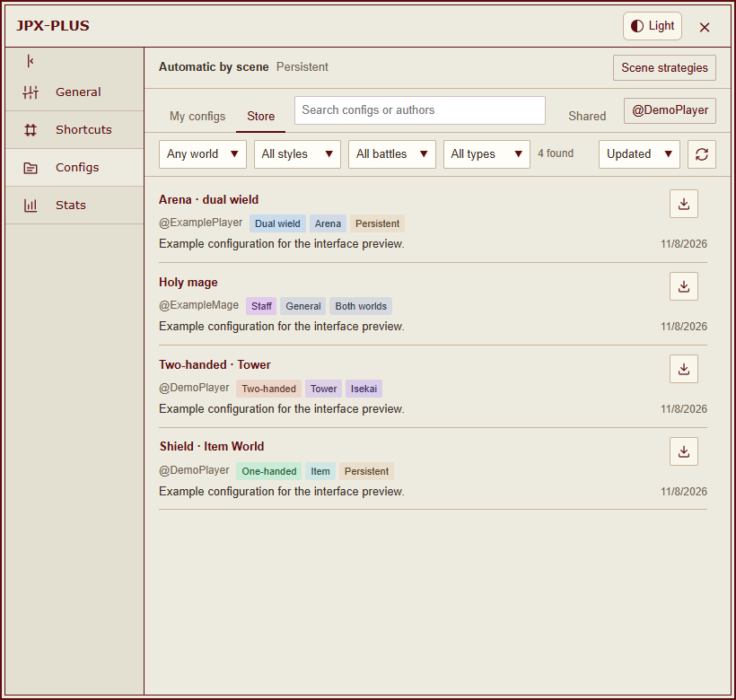</picture></a></td><td valign="top"><a href="https://meiyongai.github.io/JPX-PLUS/?lang=en&amp;page=shared&amp;device=desktop"><picture><source media="(prefers-color-scheme: dark)" srcset="docs/images/desktop-shared-dark-en.png">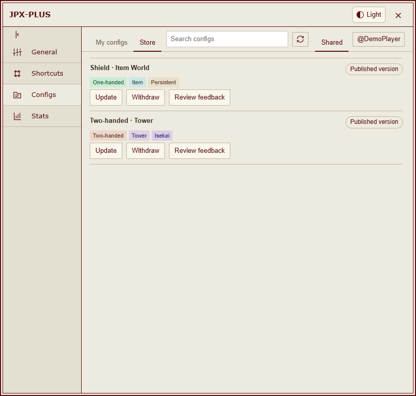</picture></a></td></tr>
</table>

같은 게시 항목을 업데이트하거나, 검토 결과를 확인하고, 공개를 취소할 수 있습니다. 공개를 취소한 항목은 내 목록에서 삭제할 수 있습니다. 업데이트 검토 중에는 이전에 승인된 버전이 계속 공개됩니다. 공유한 설정을 업데이트해도 다른 플레이어가 저장한 사본을 자동으로 덮어쓰지 않습니다.

제출한 내용은 GitHub에 공개됩니다. 검토는 형식과 기기·데이터 보안만 확인하며, 전투 전략의 좋고 나쁨을 평가하지 않습니다. 코드나 의심스러운 내용은 AI 보안 검토와 관리자의 승인이 필요합니다. [검토 정책(영어)](https://github.com/MeiYongAI/JPX-PLUS-Configs#how-sharing-works).

## 화면 미리보기

[**밝은 테마**](https://meiyongai.github.io/JPX-PLUS/?lang=en&theme=light&page=configs) · [**어두운 테마**](https://meiyongai.github.io/JPX-PLUS/?lang=en&theme=dark&page=configs) · [PC·모바일 미리보기](https://meiyongai.github.io/JPX-PLUS/?lang=en&page=configs)

테마, 언어, 기기를 바꿔 같은 화면을 비교할 수 있습니다. 스크린샷은 실제 스크립트 UI에 오프라인 예시 데이터를 표시한 것입니다. 이 README의 이미지는 영어 화면이며, 미리보기는 현재 영어와 중국어 간체를 지원합니다.

<table>
<tr><th width="50%">내 설정</th><th width="50%">스토어</th></tr>
<tr><td valign="top"><a href="https://meiyongai.github.io/JPX-PLUS/?lang=en&amp;page=configs&amp;device=mobile"><picture><source media="(prefers-color-scheme: dark)" srcset="docs/images/mobile-configs-dark-en.png">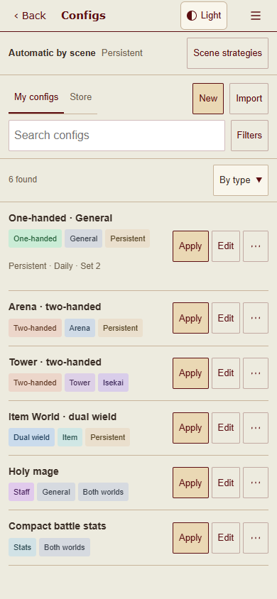</picture></a></td><td valign="top"><a href="https://meiyongai.github.io/JPX-PLUS/?lang=en&amp;page=store&amp;device=mobile"><picture><source media="(prefers-color-scheme: dark)" srcset="docs/images/mobile-store-dark-en.png">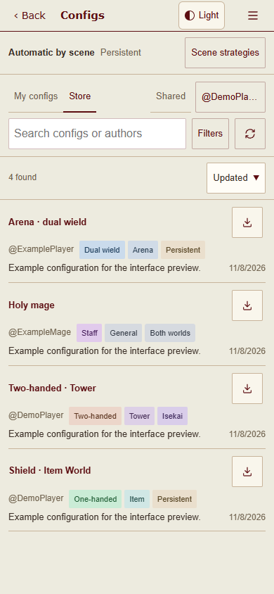</picture></a></td></tr>
</table>

모바일에서는 검색창 옆에서 필터를 펼칠 수 있습니다. 각 항목의 조작 버튼은 간결하게 배치하고, 설정 화면의 뒤로 버튼은 하나만 둡니다. HVUT 톱니바퀴 메뉴에서 설정과 통계를 열 수 있으며, 해당 메뉴가 없는 터치 기기에서는 JPX-PLUS 플로팅 버튼을 사용할 수 있습니다.

설정·통계·전투 결과

<table>
<tr><th width="50%">기본 설정</th><th width="50%">통계 색상</th></tr>
<tr><td valign="top"><a href="https://meiyongai.github.io/JPX-PLUS/?lang=en&amp;page=settings&amp;device=desktop"><picture><source media="(prefers-color-scheme: dark)" srcset="docs/images/desktop-settings-dark-en.png">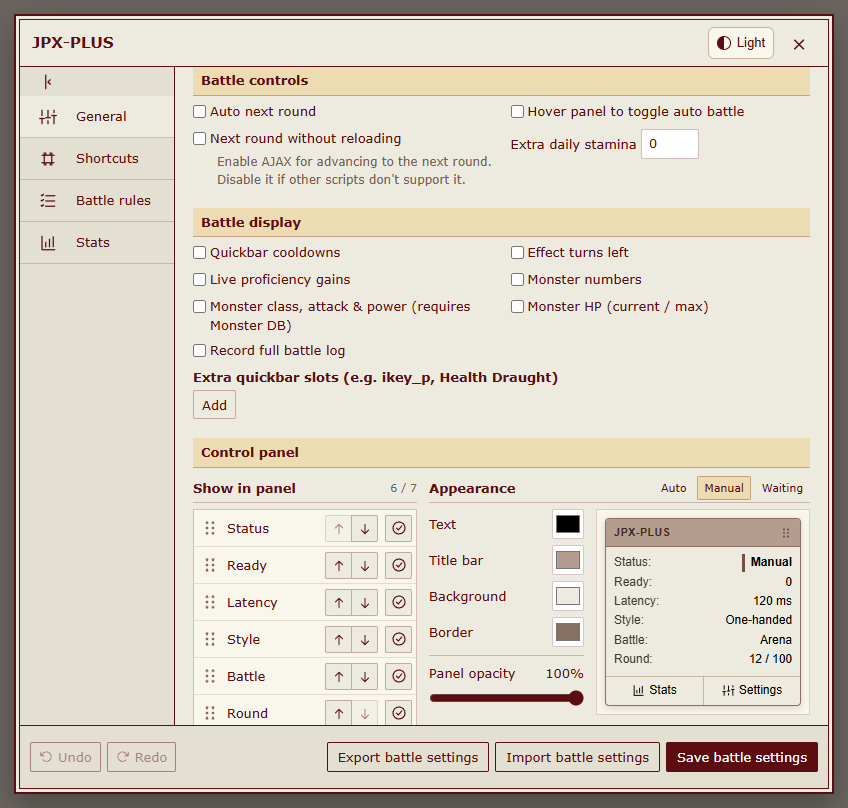</picture></a></td><td valign="top"><a href="https://meiyongai.github.io/JPX-PLUS/?lang=en&amp;page=colors&amp;device=desktop"><picture><source media="(prefers-color-scheme: dark)" srcset="docs/images/desktop-stats-settings-dark-en.png">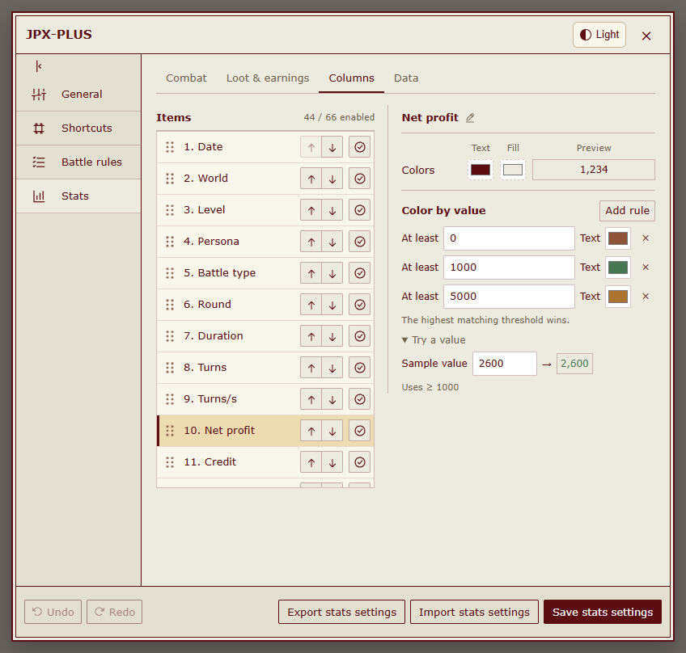</picture></a></td></tr>
</table>

<a href="https://meiyongai.github.io/JPX-PLUS/?lang=en&amp;page=records&amp;device=desktop"><picture><source media="(prefers-color-scheme: dark)" srcset="docs/images/desktop-records-dark-en.png">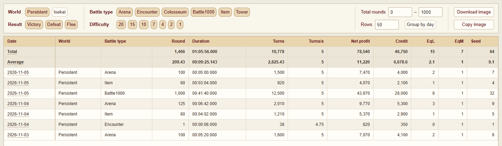</picture></a>

<table>
<tr><th width="50%">전투 상세</th><th width="50%">전투 결과</th></tr>
<tr><td valign="top"><a href="https://meiyongai.github.io/JPX-PLUS/?lang=en&amp;page=detail&amp;device=desktop"><picture><source media="(prefers-color-scheme: dark)" srcset="docs/images/desktop-detail-dark-en.png">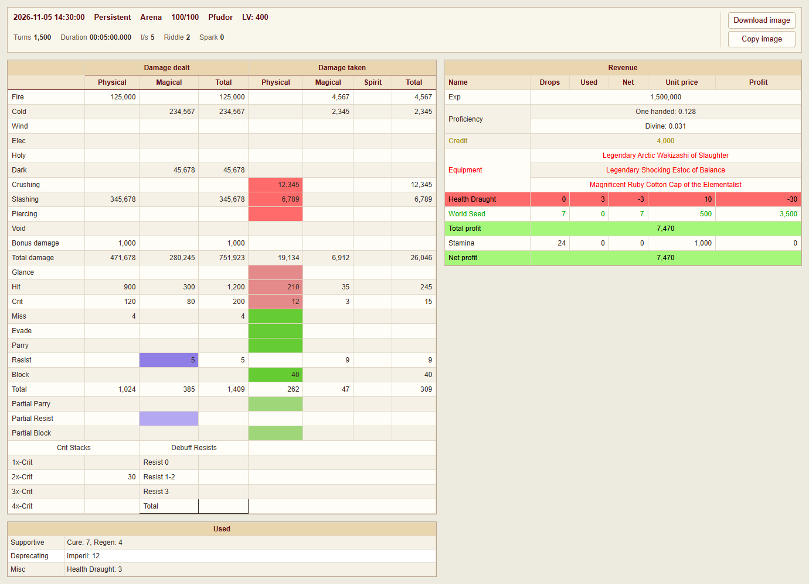</picture></a></td><td valign="top"><a href="https://meiyongai.github.io/JPX-PLUS/?lang=en&amp;page=final&amp;device=desktop"><picture><source media="(prefers-color-scheme: dark)" srcset="docs/images/desktop-final-dark-en.png">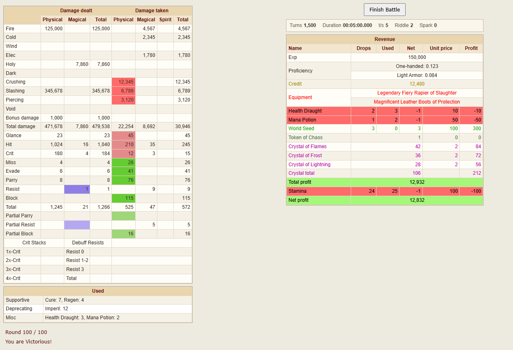</picture></a></td></tr>
</table>

<a href="https://meiyongai.github.io/JPX-PLUS/?lang=en&amp;page=panel&amp;device=desktop"><picture><source media="(prefers-color-scheme: dark)" srcset="docs/images/control-panel-dark-en.png">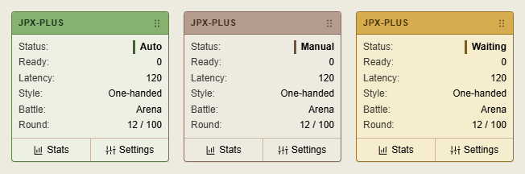</picture></a>

## 전투 통계와 조작

- 기록 필터링, 개별 전투 상세 확인, 통계 이미지 복사·다운로드.
- 기록 화면의 도구 모음에서 일별 집계, 필터, 표시 항목, 이미지, 기록 정리를 사용할 수 있습니다.
- 표시 항목은 분류별로 선택하며 변경 내용은 자동 저장되어 메인 사이트와 alt에서 공유됩니다. 사용자 지정 이름·색상·순서도 유지합니다.
- 통계 화면의 데이터 관리에서 가져오기, 내보내기, 복원, 범위별 삭제를 할 수 있습니다. 삭제 전에는 확인을 받습니다.
- 드래그로 이동하는 패널과 통계 색상을 미리 보며 조정. 밝은 테마와 어두운 테마 지원.
- 전투 규칙, 조건, 단축키 편집. 실행 취소와 다시 실행 지원.

| 기본 단축키 | 동작 |
| --- | --- |
| <kbd>M</kbd> | 자동 전투 동작 시작·일시정지 |
| <kbd>,</kbd> | 설정 열기 |
| <kbd>Z</kbd> | 전투 통계 열기 |

원작자가 2026년 11월 5일 추가한 양손 무기 기본 규칙을 반영했습니다. 기존에 저장한 규칙은 덮어쓰지 않습니다. 기본 규칙을 불러오려면 규칙 편집 화면에서 양손 설정을 열고 **규칙 초기화**를 눌러 주세요. 저장만으로 적용되지는 않으므로, 사용하려면 따로 적용해야 합니다. 원본의 300레벨 미만 안전 모드도 패배를 완전히 막아 주지는 않습니다.

기본적으로 전투 결과 화면은 열린 상태로 남습니다. **기본 설정 → 전투 조작 → 전투 종료 후 자동으로 나가기**를 켜면 통계를 저장한 뒤 게임의 나가기 버튼을 자동으로 누릅니다. 다음 전투를 시작하지는 않습니다. 저장에 실패하면 결과 화면을 그대로 둡니다.

자동 전투 시작, 일일 출석, 로비 작업 예약은 포함되어 있지 않습니다. AJAX 라운드 전환 후 다른 스크립트가 작동하지 않는다면 기본 설정에서 해당 옵션을 꺼 주세요. AJAX 전환 시 다른 유저스크립트는 다시 불러오지 않습니다.

## 함께 쓰는 도구

| 도구 | 설치 | 토론 |
| --- | --- | --- |
| HentaiVerse 어두운 테마 · Stylus | [UserCSS](https://raw.githubusercontent.com/MeiYongAI/JPX-PLUS/main/HV-Dark.user.css) | [포럼](https://forums.e-hentai.org/index.php?showtopic=302930) |
| E-Hentai 포럼 어두운 테마 · Stylus | [UserCSS](https://raw.githubusercontent.com/MeiYongAI/JPX-PLUS/main/E-Hentai-Forums-Dark.user.css) | [포럼](https://forums.e-hentai.org/index.php?showtopic=302931) |
| HentaiVerse 중국어 번역 | [유저스크립트](https://raw.githubusercontent.com/MeiYongAI/JPX-PLUS/main/HentaiVerse-Chinese.user.js) | [중국어 게시글](https://forums.e-hentai.org/index.php?showtopic=302932) |

이 도구들은 별도로 설치합니다. 게임 중국어 번역과 JPX-PLUS 언어 팩은 서로 다른 스크립트입니다. [스크린샷·설치 방법·감사의 말(영어)](docs/addons.md).

## 피드백과 개발

[Issues](https://github.com/MeiYongAI/JPX-PLUS/issues)는 영어 또는 중국어로 작성해 주세요. 스크립트 버전, 브라우저, 월드, 문제 재현 방법을 함께 알려 주세요. 스크린샷과 내보낸 설정에서 개인 정보를 지운 뒤 올려 주세요.

개발 관련 내용은 [소스 코드·빌드·오프라인 테스트(영어)](docs/development.md)를 참고해 주세요. 실제 설치 파일은 독립적으로 실행되는 유저스크립트 하나입니다. 개발용 모듈이나 테스트 패키지는 게임에서 불러오지 않습니다.
