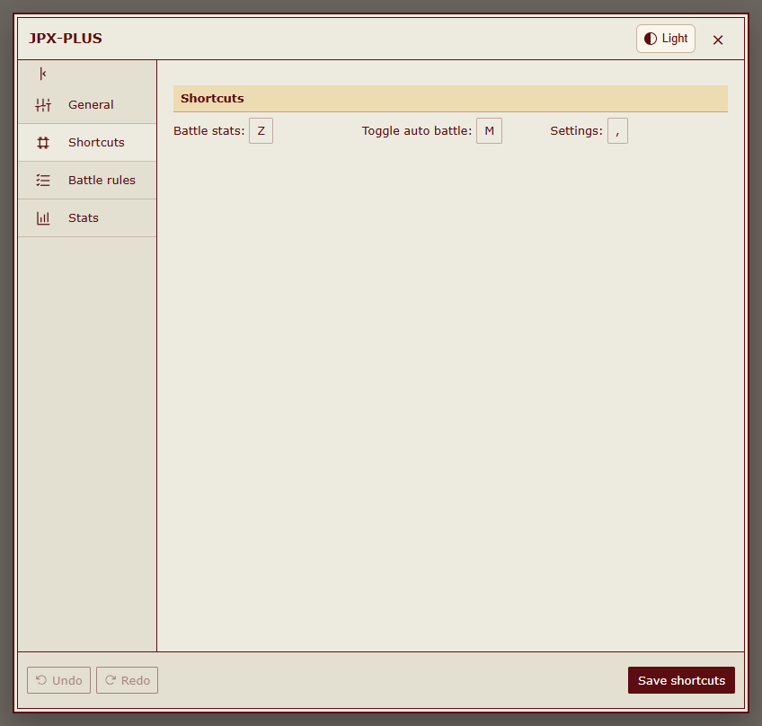
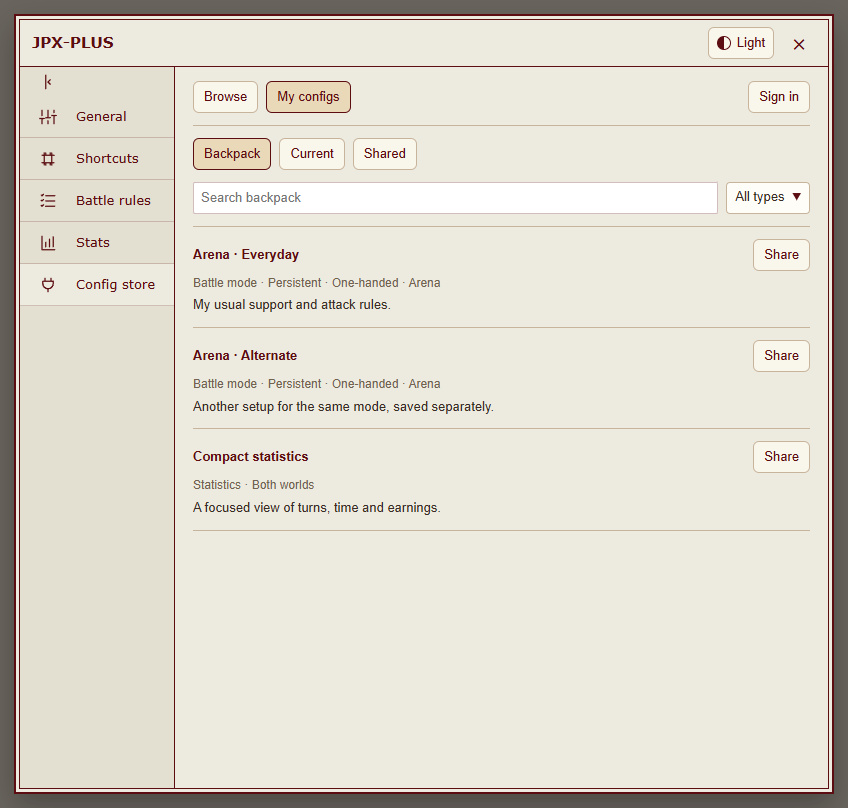
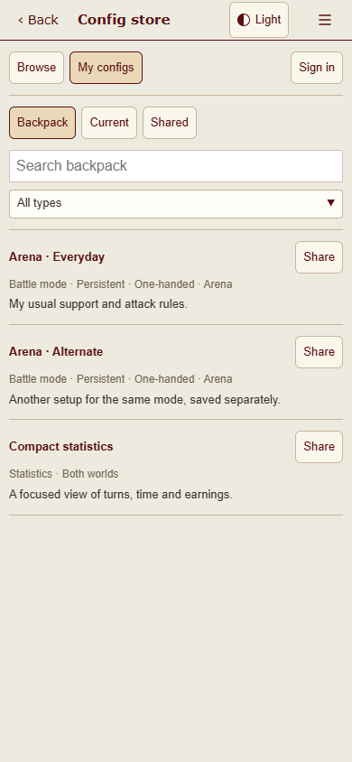
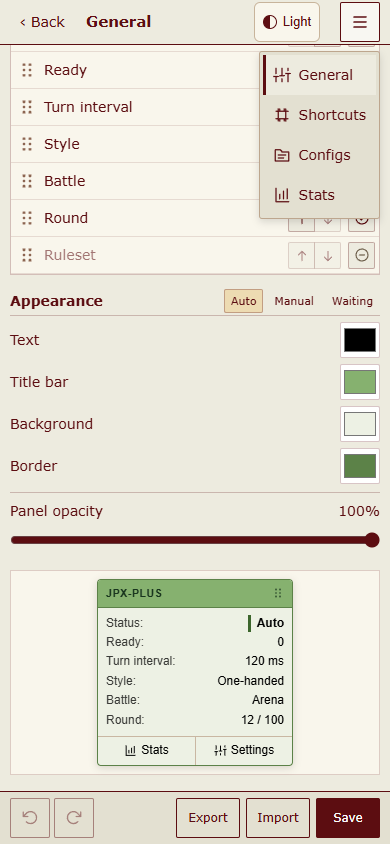
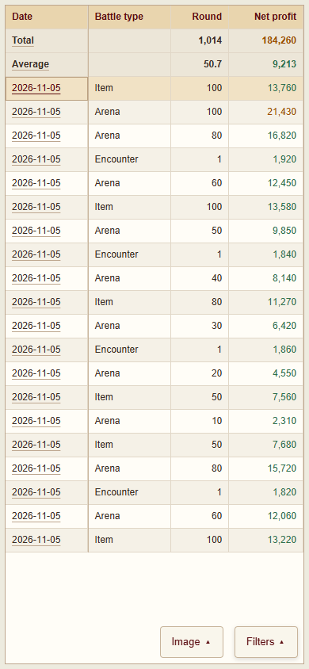
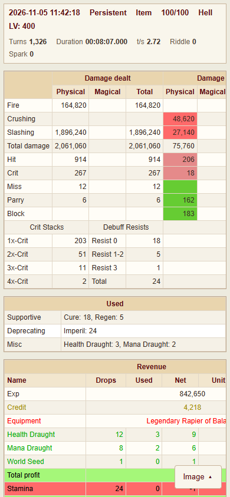

<strong>English</strong> | <a href="README.zh-CN.md">简体中文</a>

# JPX-PLUS

An enhanced JPX userscript for [HentaiVerse](https://hentaiverse.org/), with configurable battle rules, battle records, and an interface for desktop and mobile.

## Special Thanks

**Special thanks to [闯关弟子](https://forums.e-hentai.org/index.php?showuser=4802944), the original author of JPX.** JPX-PLUS builds on his work. Without him creating and sharing JPX, JPX-PLUS would not exist.

## Installation

Install [Tampermonkey](https://www.tampermonkey.net/) or [Violentmonkey](https://violentmonkey.github.io/), then install the userscript:

- [Install JPX-PLUS](https://raw.githubusercontent.com/MeiYongAI/JPX-PLUS/main/JPX-PLUS.user.js)
- [Optional: Simplified Chinese language pack](https://raw.githubusercontent.com/MeiYongAI/JPX-PLUS/main/JPX-PLUS-ZhTrans.user.js)
- [Optional: Config Store plugin](https://raw.githubusercontent.com/MeiYongAI/JPX-PLUS/main/JPX-PLUS-ConfigStore.user.js)

The main script uses English by default. The optional Chinese language pack requires the main script. Refresh the game after installation; your userscript manager checks for version updates.

When migrating from JPX or JPX-Revanced, export any settings and records you want to keep, then disable the old main script and language pack to avoid running duplicate copies. JPX-PLUS accepts the original configuration format.

## Interface Preview

  
  &nbsp;
  

Open the preview page with either theme, then switch light/dark themes and desktop/mobile views on that page. You can also browse the repository’s <a href="docs/gallery-light.md">light gallery</a> · <a href="docs/gallery-dark.md">dark gallery</a>.

The preview detects your browser language on the first visit: Chinese for Chinese-language browsers, English otherwise. Use **English / 中文** to switch the interface and screenshots; your choice is remembered. Links from each README open its matching language.

These screenshots show the current script with offline sample data. README images follow your browser’s light/dark preference. Default control-panel colors follow the theme; custom colors are preserved. The preview page switches between screenshots of the same view.

### Settings and Colors

<table>
<tr><th width="50%">Basic settings</th><th width="50%">Battle rules</th></tr>
<tr><td valign="top"><a href="https://meiyongai.github.io/JPX-PLUS/?lang=en&amp;page=settings&amp;device=desktop"><picture><source media="(prefers-color-scheme: dark)" srcset="docs/images/desktop-settings-dark-en.png"><source media="(prefers-color-scheme: light)" srcset="docs/images/desktop-settings-light-en.png"></picture></a></td><td valign="top"><a href="https://meiyongai.github.io/JPX-PLUS/?lang=en&amp;page=rules&amp;device=desktop"><picture><source media="(prefers-color-scheme: dark)" srcset="docs/images/desktop-rules-dark-en.png"><source media="(prefers-color-scheme: light)" srcset="docs/images/desktop-rules-en.png"></picture></a></td></tr>
</table>

Statistics colors and live preview

<a href="https://meiyongai.github.io/JPX-PLUS/?lang=en&amp;page=colors&amp;device=desktop"><picture><source media="(prefers-color-scheme: dark)" srcset="docs/images/desktop-stats-settings-dark-en.png"><source media="(prefers-color-scheme: light)" srcset="docs/images/desktop-stats-settings-en.png"></picture></a>

Custom shortcuts

<a href="https://meiyongai.github.io/JPX-PLUS/?lang=en&amp;page=keybindings&amp;device=desktop"><picture><source media="(prefers-color-scheme: dark)" srcset="docs/images/desktop-keybindings-dark-en.png"><source media="(prefers-color-scheme: light)" srcset="docs/images/desktop-keybindings-en.png"></picture></a>

### Battle Statistics

Filter records, aggregate revenue, inspect individual battles, and copy or download statistics as images. Choose which metrics to show in Statistics settings.

<a href="https://meiyongai.github.io/JPX-PLUS/?lang=en&amp;page=records&amp;device=desktop"><picture><source media="(prefers-color-scheme: dark)" srcset="docs/images/desktop-records-dark-en.png"><source media="(prefers-color-scheme: light)" srcset="docs/images/desktop-records-en.png"></picture></a>

<table>
<tr><th width="50%">Battle details</th><th width="50%">Battle results</th></tr>
<tr><td valign="top"><a href="https://meiyongai.github.io/JPX-PLUS/?lang=en&amp;page=detail&amp;device=desktop"><picture><source media="(prefers-color-scheme: dark)" srcset="docs/images/desktop-detail-dark-en.png"><source media="(prefers-color-scheme: light)" srcset="docs/images/desktop-detail-en.png"></picture></a></td><td valign="top"><a href="https://meiyongai.github.io/JPX-PLUS/?lang=en&amp;page=final&amp;device=desktop"><picture><source media="(prefers-color-scheme: dark)" srcset="docs/images/desktop-final-dark-en.png"><source media="(prefers-color-scheme: light)" srcset="docs/images/desktop-final-en.png"></picture></a></td></tr>
</table>

### Floating Control Panel

Drag the title bar to move the panel. Customize its text, title bar, background, border, and opacity. Default colors follow the theme; custom colors are preserved.

<a href="https://meiyongai.github.io/JPX-PLUS/?lang=en&amp;page=panel"><picture><source media="(prefers-color-scheme: dark)" srcset="docs/images/control-panel-dark-en.png"><source media="(prefers-color-scheme: light)" srcset="docs/images/control-panel-en.png"></picture></a>

### Config Store and Backpack

The optional Config Store plugin lets you browse shared configs and keep your own alternatives in a local backpack. Apply a config, then use Save in Settings to keep the change.

<table>
<tr><th width="50%">Config Store</th><th width="50%">Local backpack</th></tr>
<tr><td valign="top"><a href="https://meiyongai.github.io/JPX-PLUS/?lang=en&amp;page=store&amp;device=desktop"><picture><source media="(prefers-color-scheme: dark)" srcset="docs/images/desktop-store-dark-en.png"><source media="(prefers-color-scheme: light)" srcset="docs/images/desktop-store-en.png"></picture></a></td><td valign="top"><a href="https://meiyongai.github.io/JPX-PLUS/?lang=en&amp;page=backpack&amp;device=desktop"><picture><source media="(prefers-color-scheme: dark)" srcset="docs/images/desktop-backpack-dark-en.png"><source media="(prefers-color-scheme: light)" srcset="docs/images/desktop-backpack-en.png"></picture></a></td></tr>
</table>

Store and backpack on mobile

<table>
<tr><th width="50%">Config Store</th><th width="50%">Local backpack</th></tr>
<tr><td valign="top"><a href="https://meiyongai.github.io/JPX-PLUS/?lang=en&amp;page=store&amp;device=mobile"><picture><source media="(prefers-color-scheme: dark)" srcset="docs/images/mobile-store-dark-en.png"><source media="(prefers-color-scheme: light)" srcset="docs/images/mobile-store-en.png"></picture></a></td><td valign="top"><a href="https://meiyongai.github.io/JPX-PLUS/?lang=en&amp;page=backpack&amp;device=mobile"><picture><source media="(prefers-color-scheme: dark)" srcset="docs/images/mobile-backpack-dark-en.png"><source media="(prefers-color-scheme: light)" srcset="docs/images/mobile-backpack-en.png"></picture></a></td></tr>
</table>

### Mobile

Full-screen settings use a compact navigation menu. Statistics filters open when needed, and detail tables scroll horizontally.

<table>
<tr><th width="33%">Settings and navigation</th><th width="33%">Battle statistics</th><th width="33%">Battle details</th></tr>
<tr><td valign="top"><a href="https://meiyongai.github.io/JPX-PLUS/?lang=en&amp;page=settings&amp;device=mobile"><picture><source media="(prefers-color-scheme: dark)" srcset="docs/images/mobile-settings-dark-en.png"><source media="(prefers-color-scheme: light)" srcset="docs/images/mobile-settings-en.png"></picture></a></td><td valign="top"><a href="https://meiyongai.github.io/JPX-PLUS/?lang=en&amp;page=records&amp;device=mobile"><picture><source media="(prefers-color-scheme: dark)" srcset="docs/images/mobile-records-dark-en.png"><source media="(prefers-color-scheme: light)" srcset="docs/images/mobile-records-en.png"></picture></a></td><td valign="top"><a href="https://meiyongai.github.io/JPX-PLUS/?lang=en&amp;page=detail&amp;device=mobile"><picture><source media="(prefers-color-scheme: dark)" srcset="docs/images/mobile-detail-dark-en.png"><source media="(prefers-color-scheme: light)" srcset="docs/images/mobile-detail-en.png"></picture></a></td></tr>
</table>

## Usage

| Default key | Action |
| --- | --- |
| `M` | Start or pause automatic actions during a battle |
| `,` | Open settings |
| `Z` | Open battle statistics |

Shortcuts can be changed in Settings. With HVUT, its gear menu includes **JPX-PLUS Settings** and **JPX-PLUS Stats**; tap the gear to open or close it on mobile. Touch pages without that menu keep the JPX-PLUS floating entry. The battle panel also provides both shortcuts. Review your battle style and rules before first use.

### Optional Config Store

The independent **Config Store** plugin requires JPX-PLUS **2026.11.06.8 or later** and adds a tab inside Settings. Browse, preview, download, and import shared configs without signing in. Imports use the usual undo and save controls.

With JPX-PLUS **2026.11.06.10 or later**, **My configs → Current** lists your current configurations by world, battle style, and battle type. Preview the one you want to share, or choose full battle or statistics settings. Sign in to GitHub when submitting; complete the first authorization on GitHub, then submit, update, and withdraw your shares from JPX-PLUS. The selected configuration and description are **public on GitHub and sent for AI review**. Automated checks and AI review run before listing a config; uncertain results go to the maintainer. Check progress under **My configs → Shared**.

With Config Store **2026.11.06.5 or later**, **My configs → Backpack** keeps multiple configs of the same kind, world, and battle mode. Save your own snapshots from **Current**, or save a config from the store, then name, preview, apply, or share each one separately. The backpack stays in this plugin's local userscript storage; saving there needs no GitHub login and changes no active settings. Applying uses the existing import, undo, and manual Save controls. Downloads keep the original JPX config format.

Plugin contributors: [source, build, and test instructions](plugins/config-store/README.md).

## Features

- Configure battle rules, conditions, and shortcuts, with undo and redo.
- Optional Config Store with a local backpack for multiple saved configs and GitHub sharing.
- Advance to the next round as configured; show cooldowns, effect durations, proficiency gains, and monster HP. Detailed monster information requires a Monster DB script.
- Battle and revenue statistics, filtered summaries, historical details, and image copying or downloads.
- A draggable control panel, live color previews, light/dark themes, and mobile layouts.
- Import and export battle settings, statistics settings, and records.

### Two-handed defaults

Includes the two-handed auto-battle rules from 闯关弟子’s **November 5, 2026** JPX update. Existing saved rules are preserved. To load the new defaults, open **Battle rules**, choose the two-handed general mode, then use **Reset** (Reset Current Battle Mode) and save. Export any rules you want to keep before resetting.

The upstream rules enable their conservative Safe Mode for characters **below level 300**. This does not guarantee survival.

Automatic battle start, daily check-in, Random Encounters, Arenas, and Ring of Blood scheduling are not included. Their old configuration fields are retained only for compatibility and do nothing. The results page stays open after a battle ends.

## AJAX Round Transitions

AJAX replaces the battle area without making your userscript manager inject other scripts again. Some translation, Monster DB, HVUT, or puzzle-helper features may stop working. If that happens, disable AJAX round transitions; you can keep automatic advancement to the next round enabled.

## Feedback

Report problems or suggest improvements in [Issues](https://github.com/MeiYongAI/JPX-PLUS/issues). The issue forms and pull request template accept English or Chinese.

Thanks also to the maintainers of related tools.
