
<strong>English</strong> | <a href="README.zh-CN.md">简体中文</a> | <a href="README.zh-TW.md">繁體中文（台灣）</a> | <a href="README.zh-HK.md">繁體中文（香港）</a> | <a href="README.ja.md">日本語</a> | <a href="README.ko.md">한국어</a>

# JPX-PLUS

An enhanced JPX userscript for HentaiVerse: manage multiple configs, edit battle rules, share setups, and review battle stats on desktop or mobile.

**Special thanks to [闯关弟子](https://forums.e-hentai.org/index.php?showuser=4802944), the original JPX author.** JPX-PLUS builds on his work. Without him creating and sharing JPX, this project would not exist.

**[Install JPX-PLUS](https://raw.githubusercontent.com/MeiYongAI/JPX-PLUS/main/JPX-PLUS.user.js)** · **[Interactive preview](https://meiyongai.github.io/JPX-PLUS/?lang=en&page=configs)** · [What's changed](CHANGELOG.md)

## Install

1. Install JPX-PLUS in your userscript manager, then refresh HentaiVerse.
2. English is built in. For another language, enable **one** language pack alongside the main script:

[简体中文](https://raw.githubusercontent.com/MeiYongAI/JPX-PLUS/main/JPX-PLUS-ZhTrans.user.js) · [繁體中文（台灣）](https://raw.githubusercontent.com/MeiYongAI/JPX-PLUS/main/JPX-PLUS-ZhTW.user.js) · [繁體中文（香港）](https://raw.githubusercontent.com/MeiYongAI/JPX-PLUS/main/JPX-PLUS-ZhHK.user.js) · [日本語](https://raw.githubusercontent.com/MeiYongAI/JPX-PLUS/main/JPX-PLUS-Ja.user.js) · [한국어](https://raw.githubusercontent.com/MeiYongAI/JPX-PLUS/main/JPX-PLUS-Ko.user.js)

Update the main script and your language pack together. GitHub update URLs are included; automatic checks follow your userscript-manager settings.

**Configs and Store are included in the main script.** No separate store installation is needed. Coming from JPX? See the short [upgrade guide](docs/upgrading.md).

**Primary / alt shared data:** the same userscript installation shares settings, completed battle history and daily stamina across both hosts. Visit each host once outside combat after updating. Old copies and stamina migration controls are under **Stats → Data**. [Scope and migration details](docs/alt-shared-data-2026-11-08.md).

## Configs

Keep several setups for the same style, battle and world. **My configs** handles saving, renaming, filtering and sorting; **Edit** opens a separate rule editor.

<table>
<tr><th width="50%">My configs</th><th width="50%">Rule editor</th></tr>
<tr><td valign="top"><a href="https://meiyongai.github.io/JPX-PLUS/?lang=en&amp;page=configs&amp;device=desktop"><picture><source media="(prefers-color-scheme: dark)" srcset="docs/images/desktop-configs-dark-en.png"></picture></a></td><td valign="top"><a href="https://meiyongai.github.io/JPX-PLUS/?lang=en&amp;page=rules&amp;device=desktop"><picture><source media="(prefers-color-scheme: dark)" srcset="docs/images/desktop-rules-dark-en.png">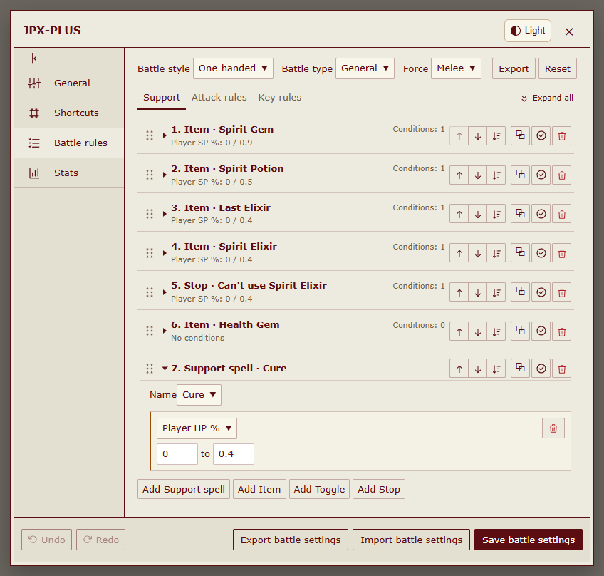</picture></a></td></tr>
</table>

- **Apply** uses the selected rule set immediately. **In use** marks the applied copy; **Current style** separately marks the detected equipment style. Applying during battle pauses automatic actions.
- **Save** in the editor updates your saved copy. Use **Update & apply** when you want the edited rules to take effect.
- **More → Bind loadout** links a config to a world's persona and equipment set. Switching to that combination applies its saved rules. One config can serve several sets; unbound sets keep the current rules.
- Colored tags identify styles, worlds, battle types and elements consistently in both themes. Tags come from the config's rule groups. Filter by world, style, battle or type; search by name and tags. Sort by type, update time, name, or drag configs into a manual order.
- Import original JPX files. Export the rules **In use**, the **Full config**, or **Choose rules**. A full config keeps the original automatic group routing.

Loadout bindings and Export rules

<table>
<tr><th width="50%">Loadout bindings</th><th width="50%">Export rules</th></tr>
<tr><td valign="top"><a href="https://meiyongai.github.io/JPX-PLUS/?lang=en&amp;page=bindings&amp;device=desktop"><picture><source media="(prefers-color-scheme: dark)" srcset="docs/images/desktop-bindings-dark-en.png">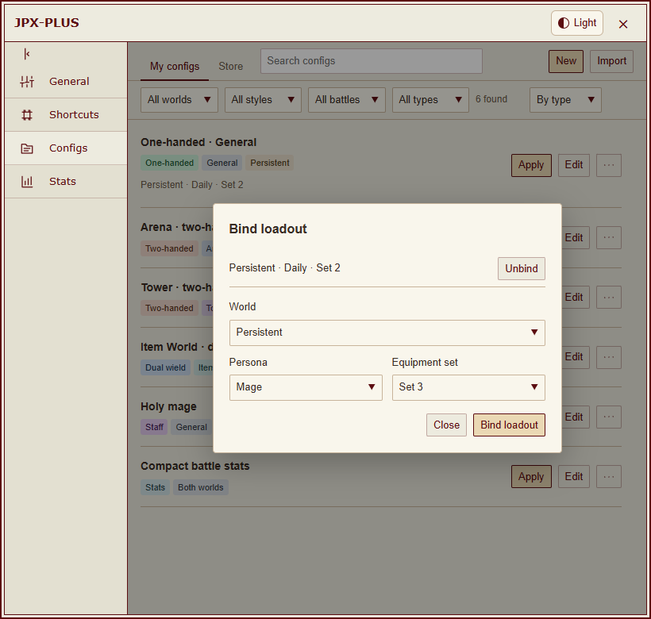</picture></a></td><td valign="top"><a href="https://meiyongai.github.io/JPX-PLUS/?lang=en&amp;page=export&amp;device=desktop"><picture><source media="(prefers-color-scheme: dark)" srcset="docs/images/desktop-export-dark-en.png">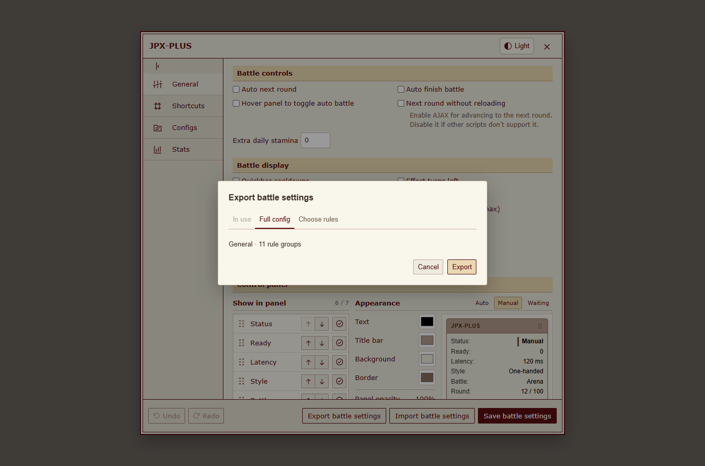</picture></a></td></tr>
</table>

### Store and sharing

Browse and download without signing in. Save a store config to **My configs**, then apply it when ready. Sign in with GitHub to share a saved config and manage it under **Shared**.

<table>
<tr><th width="50%">Store</th><th width="50%">Shared configs</th></tr>
<tr><td valign="top"><a href="https://meiyongai.github.io/JPX-PLUS/?lang=en&amp;page=store&amp;device=desktop"><picture><source media="(prefers-color-scheme: dark)" srcset="docs/images/desktop-store-dark-en.png">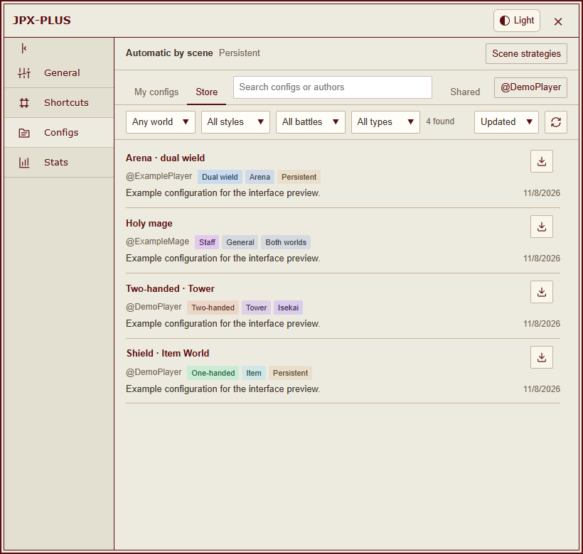</picture></a></td><td valign="top"><a href="https://meiyongai.github.io/JPX-PLUS/?lang=en&amp;page=shared&amp;device=desktop"><picture><source media="(prefers-color-scheme: dark)" srcset="docs/images/desktop-shared-dark-en.png">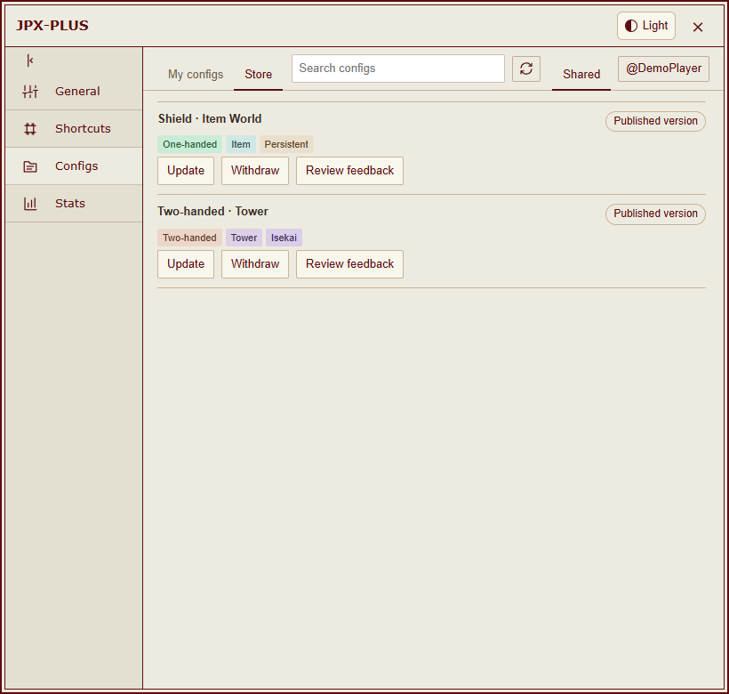</picture></a></td></tr>
</table>

Update the same listing, check review feedback, withdraw it, or remove a withdrawn submission from your list. The previous approved version stays available while an update is reviewed. Updating a share never silently replaces another player's saved copy.

Submissions are public on GitHub. Review checks format and device/data security, not battle strategy. Code and suspicious content require AI security review and maintainer approval. [Review policy](https://github.com/MeiYongAI/JPX-PLUS-Configs#how-sharing-works).

## Interface preview

[**Light theme**](https://meiyongai.github.io/JPX-PLUS/?lang=en&theme=light&page=configs) · [**Dark theme**](https://meiyongai.github.io/JPX-PLUS/?lang=en&theme=dark&page=configs) · [Desktop and mobile gallery](https://meiyongai.github.io/JPX-PLUS/?lang=en&page=configs)

Switch the theme, language or device to compare the same page. Screenshots use the actual script UI with offline sample data.

<table>
<tr><th width="50%">My configs</th><th width="50%">Store</th></tr>
<tr><td valign="top"><a href="https://meiyongai.github.io/JPX-PLUS/?lang=en&amp;page=configs&amp;device=mobile"><picture><source media="(prefers-color-scheme: dark)" srcset="docs/images/mobile-configs-dark-en.png">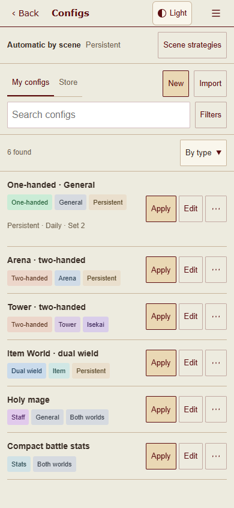</picture></a></td><td valign="top"><a href="https://meiyongai.github.io/JPX-PLUS/?lang=en&amp;page=store&amp;device=mobile"><picture><source media="(prefers-color-scheme: dark)" srcset="docs/images/mobile-store-dark-en.png">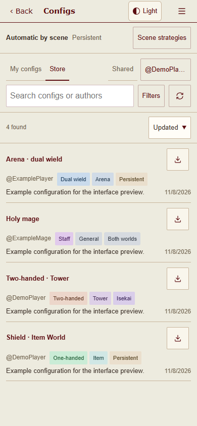</picture></a></td></tr>
</table>

On mobile, filters fold beside search, row actions stay compact, and settings use a single Back control. The HVUT gear menu includes Settings and Stats; touch pages without it retain the JPX-PLUS floating entry.

Settings, stats and battle results

<table>
<tr><th width="50%">Basic settings</th><th width="50%">Statistics colors</th></tr>
<tr><td valign="top"><a href="https://meiyongai.github.io/JPX-PLUS/?lang=en&amp;page=settings&amp;device=desktop"><picture><source media="(prefers-color-scheme: dark)" srcset="docs/images/desktop-settings-dark-en.png">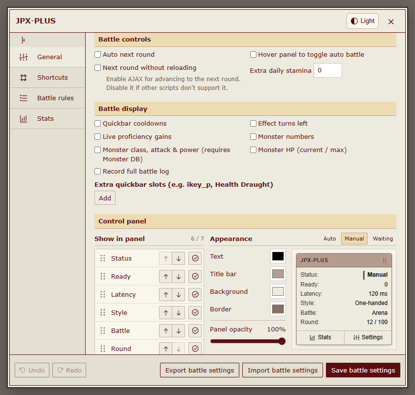</picture></a></td><td valign="top"><a href="https://meiyongai.github.io/JPX-PLUS/?lang=en&amp;page=colors&amp;device=desktop"><picture><source media="(prefers-color-scheme: dark)" srcset="docs/images/desktop-stats-settings-dark-en.png">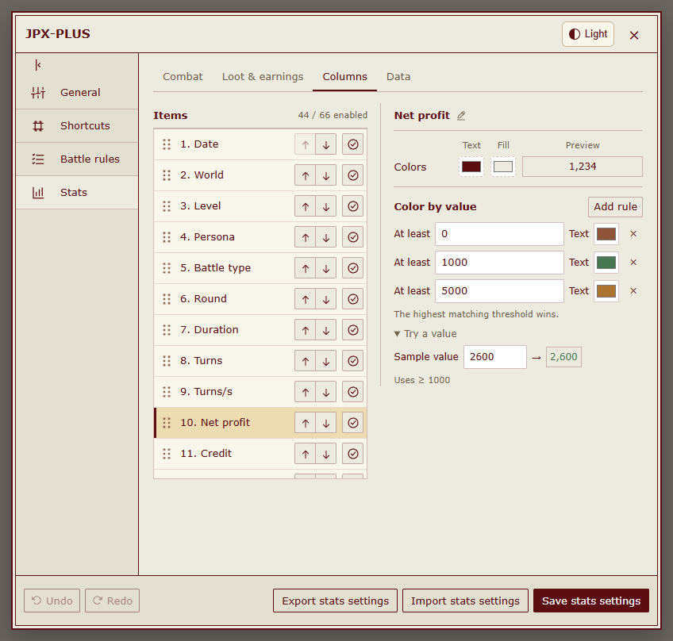</picture></a></td></tr>
</table>

<a href="https://meiyongai.github.io/JPX-PLUS/?lang=en&amp;page=records&amp;device=desktop"><picture><source media="(prefers-color-scheme: dark)" srcset="docs/images/desktop-records-dark-en.png">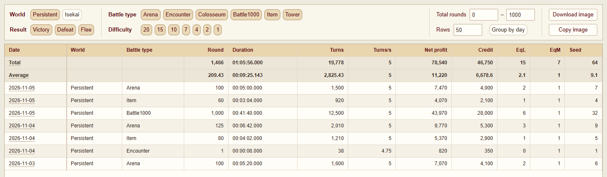</picture></a>

<table>
<tr><th width="50%">Battle details</th><th width="50%">Battle results</th></tr>
<tr><td valign="top"><a href="https://meiyongai.github.io/JPX-PLUS/?lang=en&amp;page=detail&amp;device=desktop"><picture><source media="(prefers-color-scheme: dark)" srcset="docs/images/desktop-detail-dark-en.png">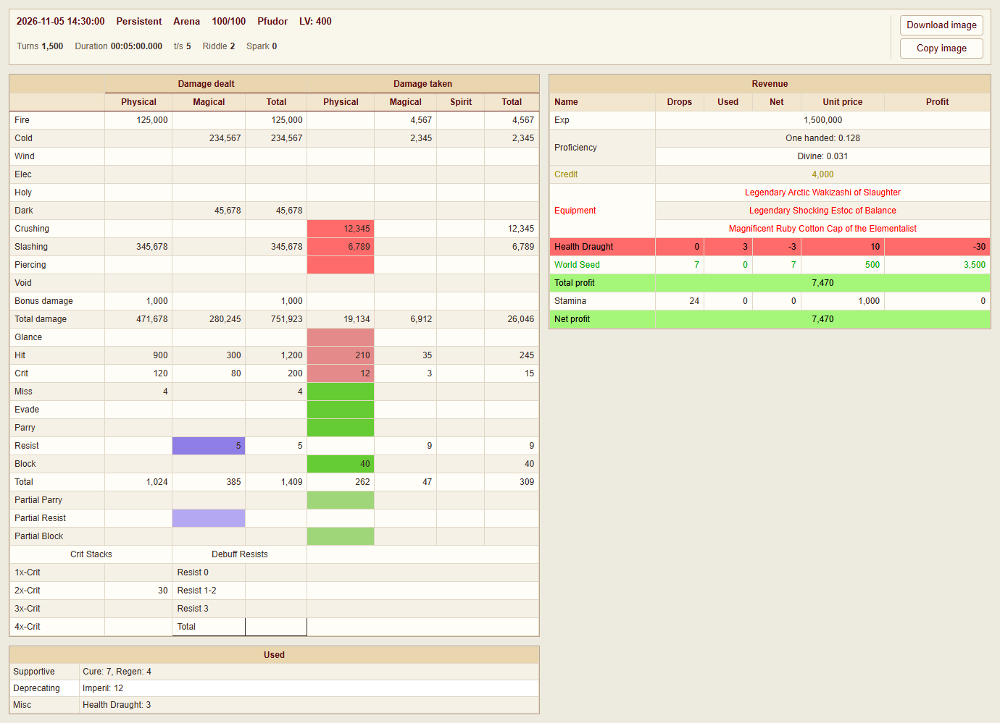</picture></a></td><td valign="top"><a href="https://meiyongai.github.io/JPX-PLUS/?lang=en&amp;page=final&amp;device=desktop"><picture><source media="(prefers-color-scheme: dark)" srcset="docs/images/desktop-final-dark-en.png">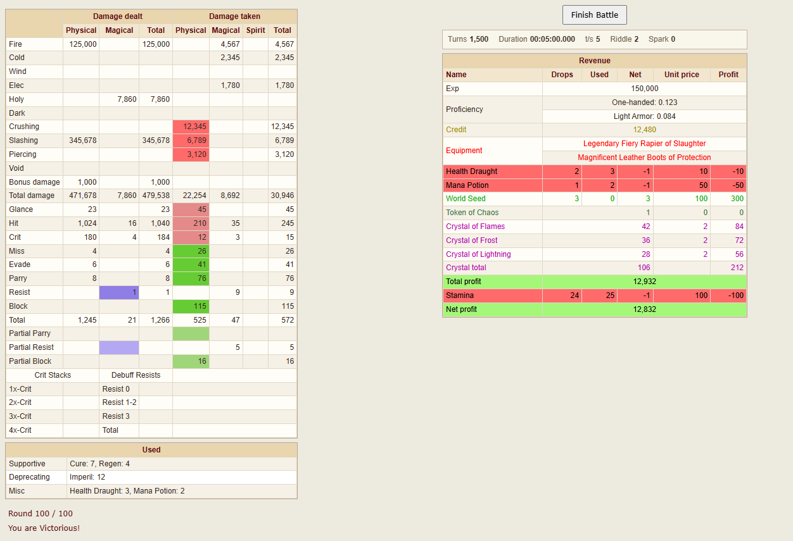</picture></a></td></tr>
</table>

<a href="https://meiyongai.github.io/JPX-PLUS/?lang=en&amp;page=panel&amp;device=desktop"><picture><source media="(prefers-color-scheme: dark)" srcset="docs/images/control-panel-dark-en.png">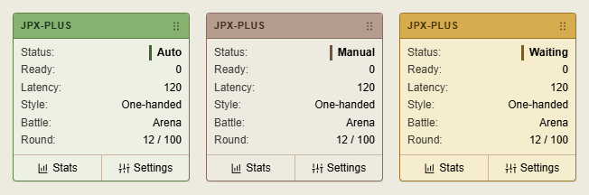</picture></a>

## Battle stats and controls

- Filter records, inspect an individual battle, and copy or download stats as an image.
- Use the eight category switches and **Choose columns** above the records table to control visibility. Changes save automatically and are shared between primary and alt; hiding a category keeps its item selections. Group headers organize the table while preserving names, colors and order within each category.
- Clear stored records by a selected range.
- Customize the draggable panel and statistics colors with live previews; choose light or dark UI.
- Edit battle rules, conditions and shortcuts with undo and redo.

| Default key | Action |
| --- | --- |
| <kbd>M</kbd> | Start or pause automatic battle actions |
| <kbd>,</kbd> | Open settings |
| <kbd>Z</kbd> | Open battle stats |

The upstream two-handed defaults from November 5, 2026 are included. Existing saved rules are preserved; open a two-handed config in the rule editor and use **Reset rules** to load its defaults. Saving that copy does not apply it. The upstream Safe Mode below level 300 does not guarantee survival.

Battle results stay open by default. Enable **General → Battle controls → Auto finish battle** to save the statistics and use the game's exit button automatically; it does not start another battle. If saving fails, the result stays open.

Automatic battle start, daily check-in and lobby task scheduling are not included. If another script stops working after AJAX round transitions, disable that option in Basic settings; AJAX does not reinject other userscripts.

## Companion scripts

| Add-on | Install | Discussion |
| --- | --- | --- |
| HentaiVerse Dark · Stylus | [UserCSS](https://raw.githubusercontent.com/MeiYongAI/JPX-PLUS/main/HV-Dark.user.css) | [Forum](https://forums.e-hentai.org/index.php?showtopic=302930) |
| E-Hentai Forums Dark · Stylus | [UserCSS](https://raw.githubusercontent.com/MeiYongAI/JPX-PLUS/main/E-Hentai-Forums-Dark.user.css) | [Forum](https://forums.e-hentai.org/index.php?showtopic=302931) |
| HentaiVerse Chinese translation | [Userscript](https://raw.githubusercontent.com/MeiYongAI/JPX-PLUS/main/HentaiVerse-Chinese.user.js) | [中文帖](https://forums.e-hentai.org/index.php?showtopic=302932) |

These are separate add-ons. The game translation is different from a JPX-PLUS language pack. [Screenshots, installation and credits](docs/addons.md).

## Feedback and development

[Issues](https://github.com/MeiYongAI/JPX-PLUS/issues) accept English or Chinese. Include your script version, browser, world and steps to reproduce. Remove private information from screenshots and exported configs.

See [source, builds and offline tests](docs/development.md). The installed script stays a single self-contained userscript; development modules and test dependencies are not loaded in the game.
