
<a href="README.md">English</a> | <strong>简体中文</strong>

# JPX-PLUS

基于 JPX 增强的 [HentaiVerse](https://hentaiverse.org/) 战斗辅助用户脚本，提供可配置的战斗规则、统计记录和适配桌面与移动端的界面。

## 特别感谢

**特别感谢 JPX 原作者 [闯关弟子](https://forums.e-hentai.org/index.php?showuser=4802944)。** JPX-PLUS 基于他的工作修改增强。没有他开发并分享 JPX，就不会有今天的 JPX-PLUS。

## 安装

先安装 [Tampermonkey](https://www.tampermonkey.net/) 或 [Violentmonkey](https://violentmonkey.github.io/)，再安装以下脚本：

- [安装 JPX-PLUS](https://raw.githubusercontent.com/MeiYongAI/JPX-PLUS/main/JPX-PLUS.user.js)
- 可选语言包：[简体中文](https://raw.githubusercontent.com/MeiYongAI/JPX-PLUS/main/JPX-PLUS-ZhTrans.user.js) · [繁體中文（台灣）](https://raw.githubusercontent.com/MeiYongAI/JPX-PLUS/main/JPX-PLUS-ZhTW.user.js) · [繁體中文（香港）](https://raw.githubusercontent.com/MeiYongAI/JPX-PLUS/main/JPX-PLUS-ZhHK.user.js) · [日本語](https://raw.githubusercontent.com/MeiYongAI/JPX-PLUS/main/JPX-PLUS-Ja.user.js) · [한국어](https://raw.githubusercontent.com/MeiYongAI/JPX-PLUS/main/JPX-PLUS-Ko.user.js)
- [可选：安装配置商店插件](https://raw.githubusercontent.com/MeiYongAI/JPX-PLUS/main/JPX-PLUS-ConfigStore.user.js)
- [可选：HentaiVerse Dark 暗色主题（Stylus 测试版）](https://github.com/MeiYongAI/JPX-PLUS/blob/main/HV-Dark.user.css)
- [可选：HentaiVerse 游戏汉化与词缀染色](https://raw.githubusercontent.com/MeiYongAI/JPX-PLUS/main/HentaiVerse-Chinese.user.js)

主脚本默认英语，其它语言通过独立语言包添加。保持主脚本启用，**一次只启用一个语言包**；切换时停用旧包、启用新包，再刷新游戏。停用所有语言包即可恢复英语。各语言包单独由脚本管理器检查更新。

四个新语言包覆盖设置、战斗统计和控制面板；配置商店与背包需要更新到 **Config Store 2026.11.06.8 或更新版本**。台湾和香港采用各自常用词汇，日语和韩语保留便于对照的物品、技能、状态英文原名。玩家分享的内容和 AI 审阅报告不会自动翻译。语言包不改变战斗规则和原版 JPX 配置格式。

HentaiVerse Dark 是适配游戏与 HVUT 的独立 UserCSS 主题，并非油猴脚本。安装 [Stylus](https://add0n.com/stylus.html) 后，从上面的主题页面打开原始 UserCSS 文件进行安装，也可将文件内容粘贴到新的 UserCSS 样式中。主题已包含更新地址，更新检查取决于 Stylus 设置。JPX-PLUS 界面仍使用自身的浅暗切换。主题目前处于测试阶段，首屏加载时机受浏览器和 Stylus 设置影响。

**HentaiVerse 游戏汉化**用于游戏文本翻译与装备词缀染色，也支持已适配的拍卖列表。它与 JPX-PLUS 界面语言包各自独立，无需 JPX-PLUS 也能使用。感谢原作者 **mbbdzz**（[原脚本](https://greasyfork.org/scripts/600755)），当前版本由 **MeiYongAI** 维护增强，保留原有 MIT 许可声明。版本号改为 **年.月.日.当日修订号**，本次为 **2026.11.06.1**。

已安装旧游戏汉化的用户，需要从 GitHub 安装一次新版，并确保这份游戏汉化只启用一个副本。新版已配置 GitHub 更新地址；旧版仍指向 Greasy Fork，不会自行迁移。脚本名称、命名空间与设置存储键保持不变。

从原版 JPX 或 JPX-Revanced 迁移时，先导出需要保留的配置与记录，再停用旧主脚本和旧语言包，避免多份脚本同时运行。JPX-PLUS 支持原版配置格式导入。

## 界面预览

  
  &nbsp;
  

选择一个主题进入展示页，在同一页面切换浅暗主题、桌面与手机视图。 也可直接在仓库查看 <a href="docs/gallery-light.zh-CN.md">浅色图集</a> · <a href="docs/gallery-dark.zh-CN.md">暗色图集</a>。

展示页首次按浏览器语言选择：中文环境显示中文，其他语言默认英文。点击 **English / 中文** 可同时切换界面与截图，并记住选择；从两版 README 进入时会使用对应语言。

截图使用当前脚本和离线示例数据，随浏览器的浅暗偏好展示对应主题；控制面板默认配色随主题切换，自定义配色保留。

### 设置与配色

<table>
<tr><th width="50%">基本设置</th><th width="50%">战斗规则</th></tr>
<tr><td valign="top"><a href="https://meiyongai.github.io/JPX-PLUS/?lang=zh-CN&amp;page=settings&amp;device=desktop"><picture><source media="(prefers-color-scheme: dark)" srcset="docs/images/desktop-settings-dark.png"><source media="(prefers-color-scheme: light)" srcset="docs/images/desktop-settings-light.png">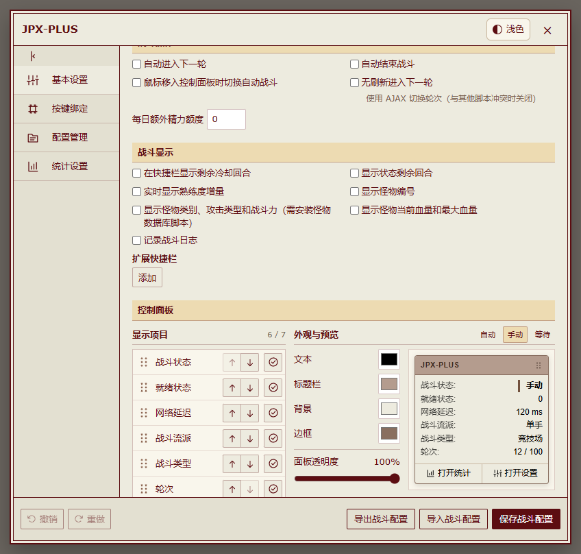</picture></a></td><td valign="top"><a href="https://meiyongai.github.io/JPX-PLUS/?lang=zh-CN&amp;page=rules&amp;device=desktop"><picture><source media="(prefers-color-scheme: dark)" srcset="docs/images/desktop-rules-dark.png"><source media="(prefers-color-scheme: light)" srcset="docs/images/desktop-rules.png">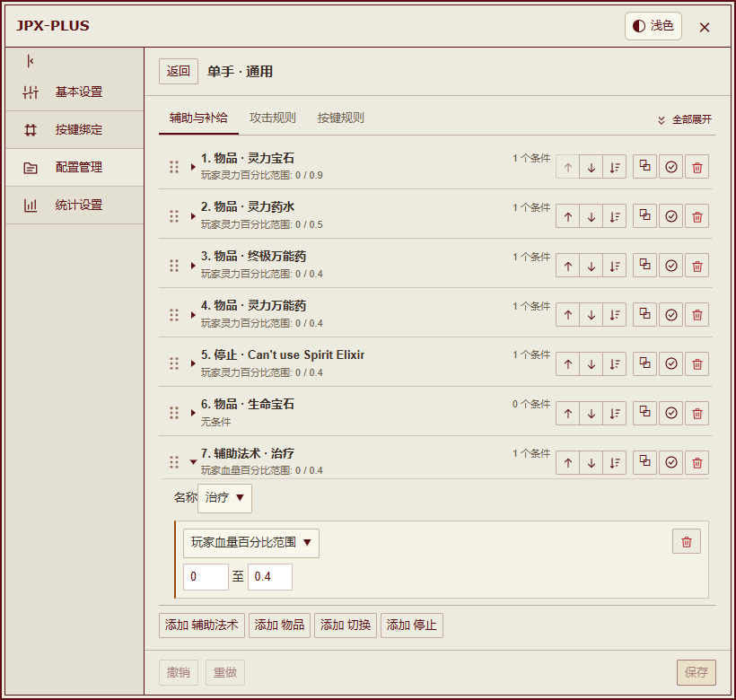</picture></a></td></tr>
</table>

统计配色与实时预览

<a href="https://meiyongai.github.io/JPX-PLUS/?lang=zh-CN&amp;page=colors&amp;device=desktop"><picture><source media="(prefers-color-scheme: dark)" srcset="docs/images/desktop-stats-settings-dark.png"><source media="(prefers-color-scheme: light)" srcset="docs/images/desktop-stats-settings.png">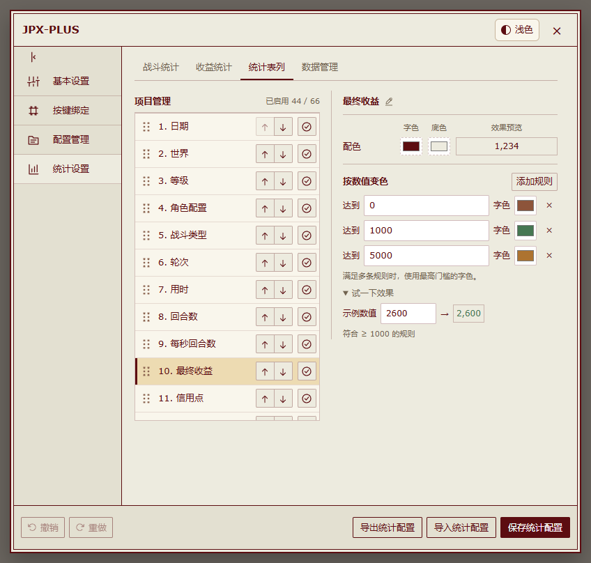</picture></a>

快捷键配置

<a href="https://meiyongai.github.io/JPX-PLUS/?lang=zh-CN&amp;page=keybindings&amp;device=desktop"><picture><source media="(prefers-color-scheme: dark)" srcset="docs/images/desktop-keybindings-dark.png"><source media="(prefers-color-scheme: light)" srcset="docs/images/desktop-keybindings.png">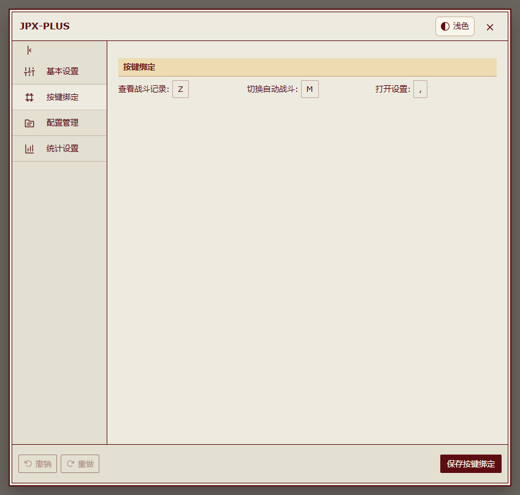</picture></a>

### 战斗统计

筛选记录、汇总收益、查看单场明细，也可以复制或下载统计图片。显示项目可在统计设置中调整。

<a href="https://meiyongai.github.io/JPX-PLUS/?lang=zh-CN&amp;page=records&amp;device=desktop"><picture><source media="(prefers-color-scheme: dark)" srcset="docs/images/desktop-records-dark.png"><source media="(prefers-color-scheme: light)" srcset="docs/images/desktop-records.png">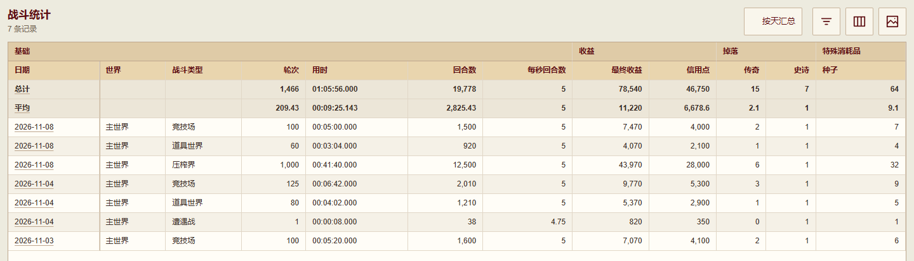</picture></a>

<table>
<tr><th width="50%">历史明细</th><th width="50%">战斗结算</th></tr>
<tr><td valign="top"><a href="https://meiyongai.github.io/JPX-PLUS/?lang=zh-CN&amp;page=detail&amp;device=desktop"><picture><source media="(prefers-color-scheme: dark)" srcset="docs/images/desktop-detail-dark.png"><source media="(prefers-color-scheme: light)" srcset="docs/images/desktop-detail.png">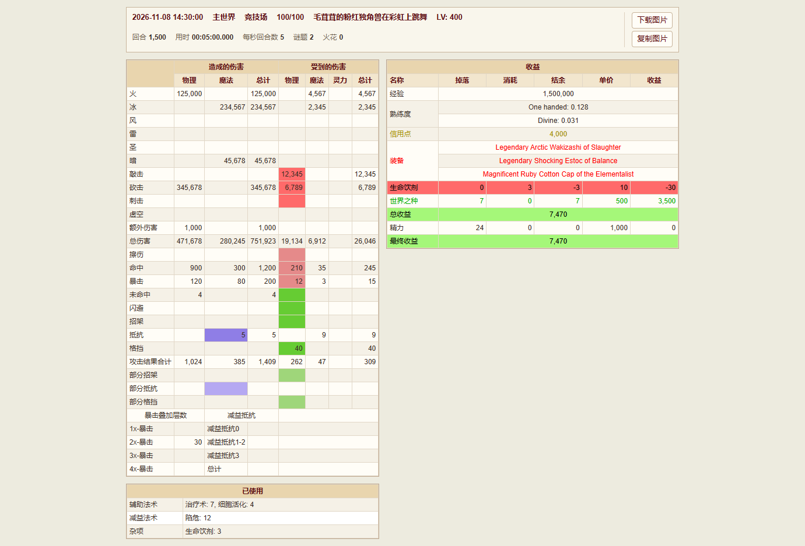</picture></a></td><td valign="top"><a href="https://meiyongai.github.io/JPX-PLUS/?lang=zh-CN&amp;page=final&amp;device=desktop"><picture><source media="(prefers-color-scheme: dark)" srcset="docs/images/desktop-final-dark.png"><source media="(prefers-color-scheme: light)" srcset="docs/images/desktop-final.png">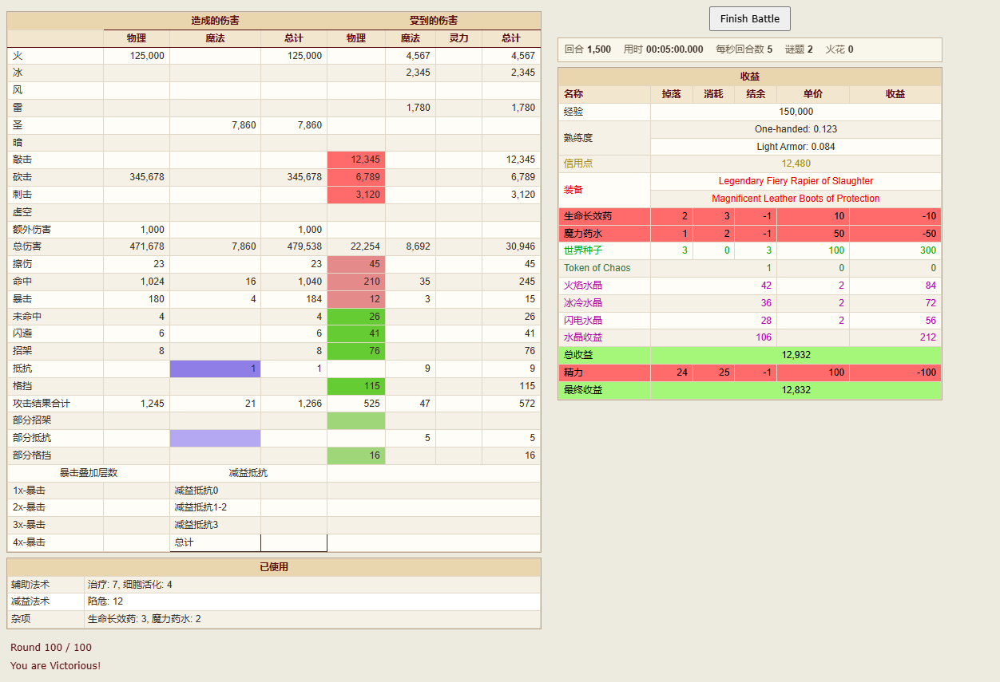</picture></a></td></tr>
</table>

### 悬浮控制面板

拖动标题栏调整位置，自定义文本、标题栏、背景、边框和面板透明度。默认配色随主题切换，自定义配色保留。

<a href="https://meiyongai.github.io/JPX-PLUS/?lang=zh-CN&amp;page=panel"><picture><source media="(prefers-color-scheme: dark)" srcset="docs/images/control-panel-dark.png"><source media="(prefers-color-scheme: light)" srcset="docs/images/control-panel.png">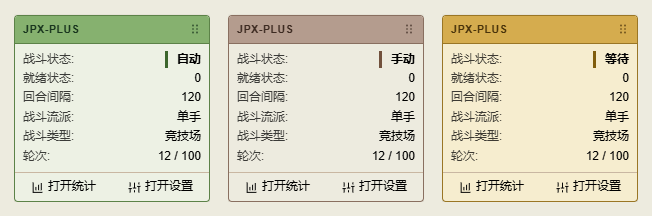</picture></a>

### 配置商店与背包

安装独立配置商店插件后，可浏览玩家分享的配置，也可在本地背包保存自己的多套同类规则。应用配置后，仍需在设置中手动保存。

<table>
<tr><th width="50%">配置商店</th><th width="50%">本地背包</th></tr>
<tr><td valign="top"><a href="https://meiyongai.github.io/JPX-PLUS/?lang=zh-CN&amp;page=store&amp;device=desktop"><picture><source media="(prefers-color-scheme: dark)" srcset="docs/images/desktop-store-dark.png"><source media="(prefers-color-scheme: light)" srcset="docs/images/desktop-store.png">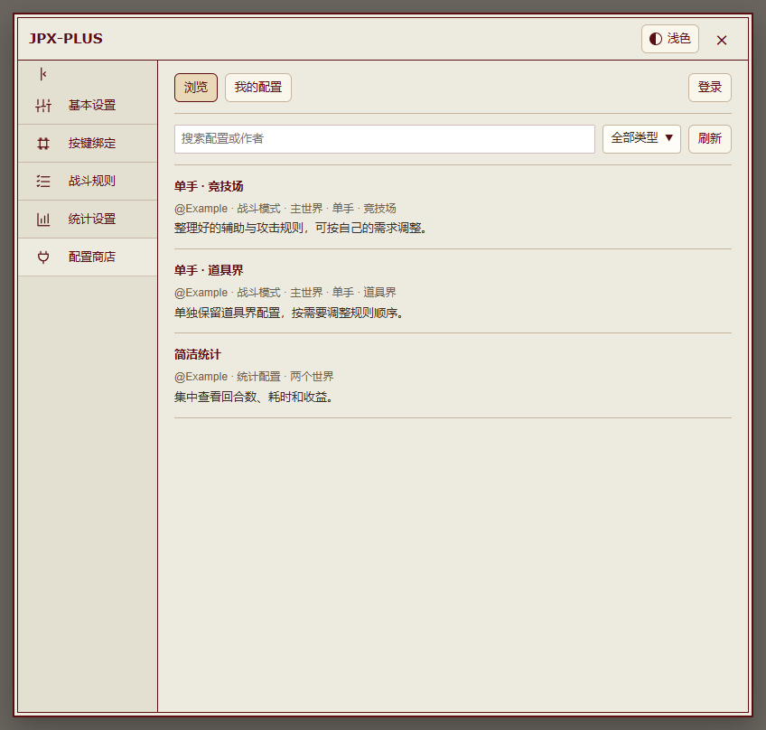</picture></a></td><td valign="top"><a href="https://meiyongai.github.io/JPX-PLUS/?lang=zh-CN&amp;page=backpack&amp;device=desktop"><picture><source media="(prefers-color-scheme: dark)" srcset="docs/images/desktop-backpack-dark.png"><source media="(prefers-color-scheme: light)" srcset="docs/images/desktop-backpack.png">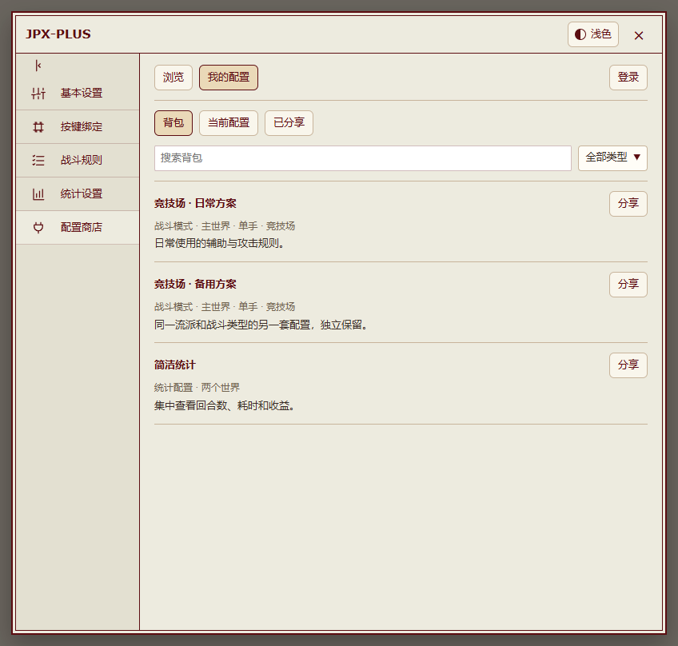</picture></a></td></tr>
</table>

手机上的商店与背包

<table>
<tr><th width="50%">配置商店</th><th width="50%">本地背包</th></tr>
<tr><td valign="top"><a href="https://meiyongai.github.io/JPX-PLUS/?lang=zh-CN&amp;page=store&amp;device=mobile"><picture><source media="(prefers-color-scheme: dark)" srcset="docs/images/mobile-store-dark.png"><source media="(prefers-color-scheme: light)" srcset="docs/images/mobile-store.png">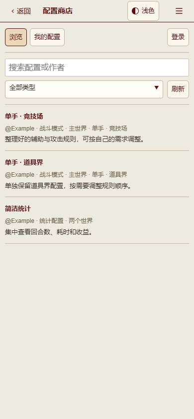</picture></a></td><td valign="top"><a href="https://meiyongai.github.io/JPX-PLUS/?lang=zh-CN&amp;page=backpack&amp;device=mobile"><picture><source media="(prefers-color-scheme: dark)" srcset="docs/images/mobile-backpack-dark.png"><source media="(prefers-color-scheme: light)" srcset="docs/images/mobile-backpack.png">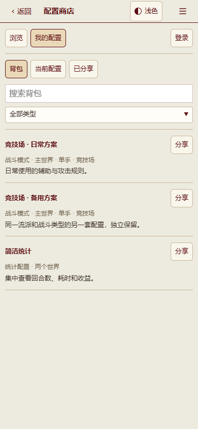</picture></a></td></tr>
</table>

### 移动端

全屏设置配合下拉导航，统计筛选按需展开，明细表格支持横向滚动。

<table>
<tr><th width="33%">设置与导航</th><th width="33%">战斗统计</th><th width="33%">单场明细</th></tr>
<tr><td valign="top"><a href="https://meiyongai.github.io/JPX-PLUS/?lang=zh-CN&amp;page=settings&amp;device=mobile"><picture><source media="(prefers-color-scheme: dark)" srcset="docs/images/mobile-settings-dark.png"><source media="(prefers-color-scheme: light)" srcset="docs/images/mobile-settings.png">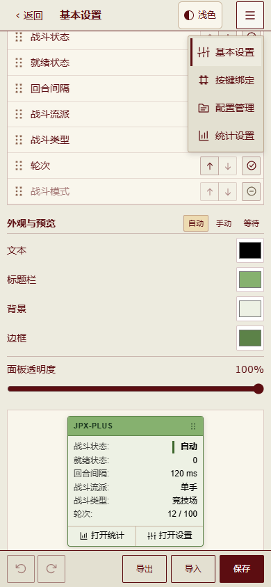</picture></a></td><td valign="top"><a href="https://meiyongai.github.io/JPX-PLUS/?lang=zh-CN&amp;page=records&amp;device=mobile"><picture><source media="(prefers-color-scheme: dark)" srcset="docs/images/mobile-records-dark.png"><source media="(prefers-color-scheme: light)" srcset="docs/images/mobile-records.png">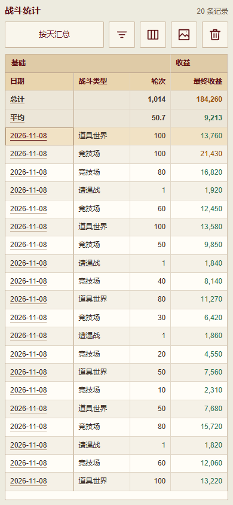</picture></a></td><td valign="top"><a href="https://meiyongai.github.io/JPX-PLUS/?lang=zh-CN&amp;page=detail&amp;device=mobile"><picture><source media="(prefers-color-scheme: dark)" srcset="docs/images/mobile-detail-dark.png"><source media="(prefers-color-scheme: light)" srcset="docs/images/mobile-detail.png">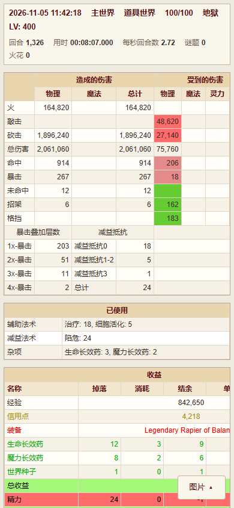</picture></a></td></tr>
</table>

## 使用

| 默认快捷键 | 操作 |
| --- | --- |
| `M` | 在战斗内启停自动操作 |
| `,` | 打开设置 |
| `Z` | 打开战斗统计 |

快捷键可以在设置中修改。安装 HVUT 后，齿轮菜单中会增加 **JPX-PLUS 设置**和 **JPX-PLUS 统计**，手机上点齿轮即可展开或收起。没有该菜单的触控页面保留 JPX-PLUS 悬浮入口，战斗面板也提供这两个入口。首次使用请先检查战斗流派和规则。

### 可选配置商店

**配置商店**是独立插件，需要 JPX-PLUS **2026.11.06.8 或更新版本**，安装后会在设置中增加入口。浏览、预览、下载和导入配置无需登录；导入沿用现有的撤销和保存流程。

使用 JPX-PLUS **2026.11.06.10 或更新版本**时，**我的配置 → 当前配置**会按世界、流派和战斗类型列出当前配置，选中后即可预览、分享，也可以选择整套战斗配置或统计配置。提交时登录 GitHub，首次按提示完成授权，随后即可在 JPX-PLUS 内提交、更新或撤下分享。所选配置和说明会**在 GitHub 公开，并发送给 AI 审阅**。通过规则校验和 AI 审阅后上架，有疑点的交给维护者确认；审核进度可在**我的配置 → 已分享**中查看。

使用配置商店 **2026.11.06.5 或更新版本**时，**我的配置 → 背包**可以存放多套同世界、同流派、同类型的配置。在**当前配置**中保存自己的方案，或从商店保存别人的配置，再分别命名、预览、应用或分享。背包单独保存在插件的本地存储中，无需登录 GitHub，也不会改变正在使用的配置。应用时沿用现有导入、撤销和手动保存流程，下载的配置仍是原版 JPX 格式。

参与插件开发：[源码、构建与测试说明](plugins/config-store/README.md)。

## 功能

- 战斗规则、条件与快捷键配置，支持撤销和重做。
- 独立配置商店插件，本地背包保存多套配置，支持通过 GitHub 分享。
- 按设置进入下一轮；显示冷却、状态持续时间、熟练度及怪物生命值。怪物详细信息需要配合 Monster DB 脚本。
- 战斗与收益统计、筛选汇总、历史明细，以及复制和下载统计图片。
- 可拖动控制面板、配色实时预览、浅暗主题及移动端布局。
- 战斗配置、统计配置和记录的导入导出。

### 双手默认规则

已同步原作者闯关弟子 **2026 年 11 月 5 日**更新的双手自动战斗规则。已有保存的规则不会被覆盖；如需加载新版默认规则，请进入**战斗规则**，选择双手通用模式，点击**重置**（重置当前战斗模式）并保存。重置前可先导出需要保留的规则。

原作者规则会为**低于 300 级**的角色启用较保守的安全模式，但仍有战败可能。

不提供自动开战、自动签到、自动遭遇战、自动竞技场或自动浴血擂台。旧配置中的对应字段仅保留用于兼容，不会执行；战斗结束后保留结算页面。

## AJAX 换轮

AJAX 局部换轮不会使脚本管理器重新注入其他用户脚本，部分汉化、Monster DB、HVUT 或谜题助手可能无法继续工作。遇到此类问题时，请关闭 AJAX 换轮，并按需保留“自动进入下一轮”。

## 反馈

在 [Issues](https://github.com/MeiYongAI/JPX-PLUS/issues) 中反馈问题或提出建议。Issue 表单和 PR 模板均可使用中文或英文填写。

同时感谢相关工具的维护者。
