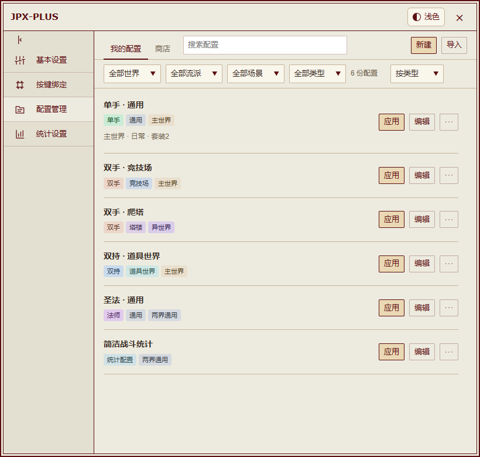
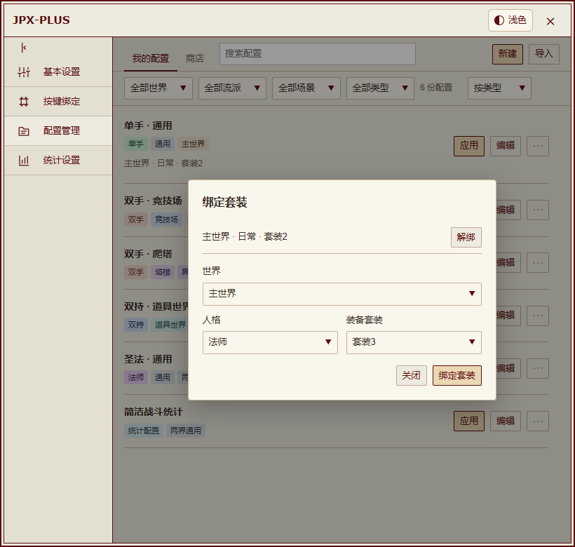
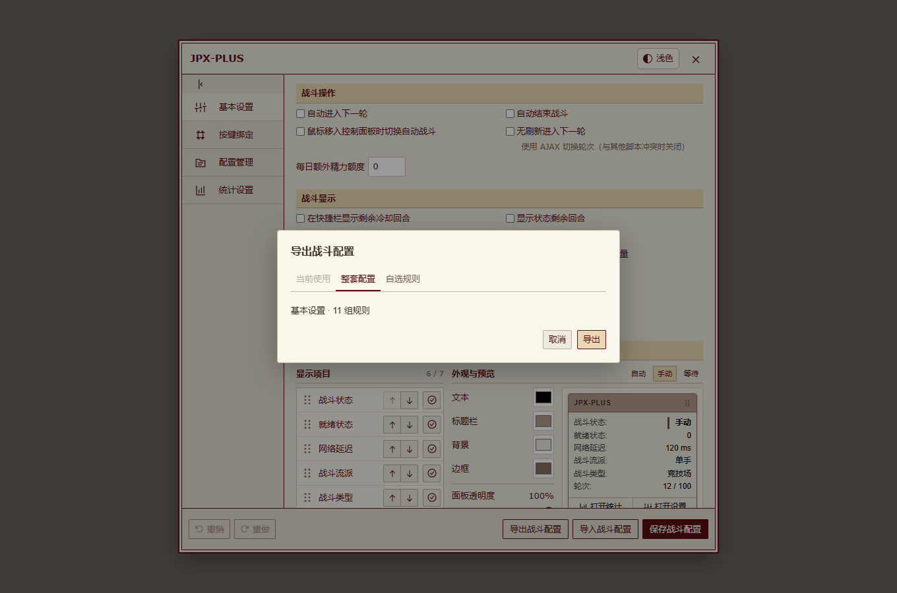
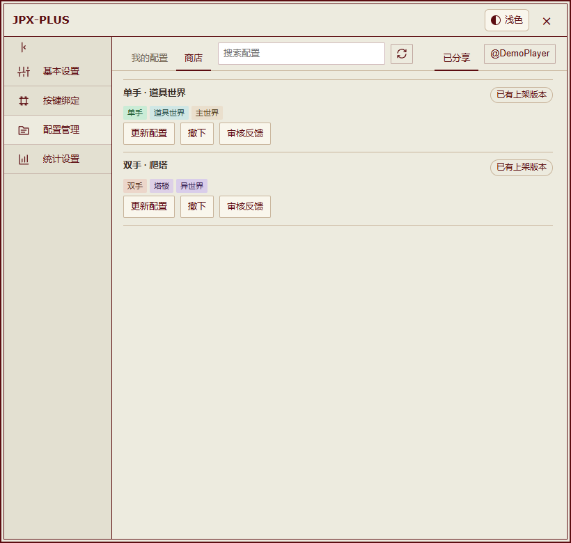
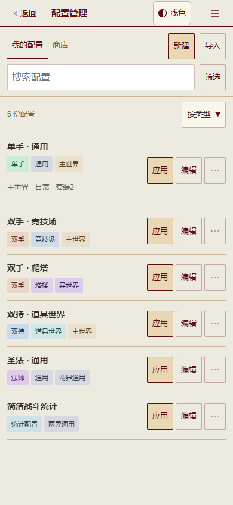

<a href="README.md">English</a> | <strong>简体中文</strong>

# JPX-PLUS

基于 JPX 增强的 HentaiVerse 脚本：管理多套配置、编辑战斗规则、分享方案，并在桌面与手机上查看战斗统计。

**特别感谢原版 JPX 作者[闯关弟子](https://forums.e-hentai.org/index.php?showuser=4802944)。** JPX-PLUS 建立在他的成果之上，没有他创作并分享 JPX，就没有今天的 JPX-PLUS。

**[安装 JPX-PLUS](https://raw.githubusercontent.com/MeiYongAI/JPX-PLUS/main/JPX-PLUS.user.js)** · **[交互预览](https://meiyongai.github.io/JPX-PLUS/?lang=zh-CN&page=configs)** · [本次改动](CHANGELOG.md#简体中文)

## 安装

1. 使用脚本管理器安装 JPX-PLUS，刷新游戏。
2. 主脚本内置英语。需要其他语言时，额外启用**一个**语言包：

[简体中文](https://raw.githubusercontent.com/MeiYongAI/JPX-PLUS/main/JPX-PLUS-ZhTrans.user.js) · [繁體中文（台灣）](https://raw.githubusercontent.com/MeiYongAI/JPX-PLUS/main/JPX-PLUS-ZhTW.user.js) · [繁體中文（香港）](https://raw.githubusercontent.com/MeiYongAI/JPX-PLUS/main/JPX-PLUS-ZhHK.user.js) · [日本語](https://raw.githubusercontent.com/MeiYongAI/JPX-PLUS/main/JPX-PLUS-Ja.user.js) · [한국어](https://raw.githubusercontent.com/MeiYongAI/JPX-PLUS/main/JPX-PLUS-Ko.user.js)

请同步更新主脚本和所用语言包。各脚本已配置 GitHub 更新地址，自动检查遵循脚本管理器设置。

**配置管理与商店已包含在主脚本内，无需再安装商店插件。** 从原版 JPX 或旧商店迁移，请看[简短的升级说明](docs/upgrading.md#简体中文)。

## 配置管理

同一流派、场景、世界可以保存多套方案。**我的配置**负责保存、重命名、筛选和排序，点击**编辑**后进入独立的规则编辑页。

<table>
<tr><th width="50%">我的配置</th><th width="50%">规则编辑</th></tr>
<tr><td valign="top"><a href="https://meiyongai.github.io/JPX-PLUS/?lang=zh-CN&amp;page=configs&amp;device=desktop"><picture><source media="(prefers-color-scheme: dark)" srcset="docs/images/desktop-configs-dark.png"></picture></a></td><td valign="top"><a href="https://meiyongai.github.io/JPX-PLUS/?lang=zh-CN&amp;page=rules&amp;device=desktop"><picture><source media="(prefers-color-scheme: dark)" srcset="docs/images/desktop-rules-dark.png"></picture></a></td></tr>
</table>

- **应用**立即使用所选规则。**使用中**标记实际应用的配置，**当前流派**单独标记识别到的装备流派。战斗中应用配置会暂停自动操作。
- 编辑页的**保存**只更新本地副本，需要生效时再点击**更新并应用**。
- **更多 → 绑定套装**可指定世界、人格和装备套装，切换到对应组合时自动应用规则。同一配置可绑定多个组合，未绑定的套装保持当前规则。
- 流派、世界、场景和元素标签统一染色，浅色与暗色均适配。标签按配置内的实际规则生成。可按世界、流派、场景、类型筛选，也能搜索名称和标签；支持按类型、更新时间、名称排序及拖动手动排序。
- 支持导入原版 JPX 配置。导出可选**使用中**、**完整配置**或**自选规则**；完整配置仍按原版方式自动选择规则组。

套装绑定与导出规则

<table>
<tr><th width="50%">套装绑定</th><th width="50%">导出规则</th></tr>
<tr><td valign="top"><a href="https://meiyongai.github.io/JPX-PLUS/?lang=zh-CN&amp;page=bindings&amp;device=desktop"><picture><source media="(prefers-color-scheme: dark)" srcset="docs/images/desktop-bindings-dark.png"></picture></a></td><td valign="top"><a href="https://meiyongai.github.io/JPX-PLUS/?lang=zh-CN&amp;page=export&amp;device=desktop"><picture><source media="(prefers-color-scheme: dark)" srcset="docs/images/desktop-export-dark.png"></picture></a></td></tr>
</table>

### 商店与分享

无需登录即可浏览、下载。将商店配置保存到**我的配置**后，再按需要应用。分享时登录 GitHub，随后可在**已分享**管理投稿。

<table>
<tr><th width="50%">商店</th><th width="50%">已分享</th></tr>
<tr><td valign="top"><a href="https://meiyongai.github.io/JPX-PLUS/?lang=zh-CN&amp;page=store&amp;device=desktop"><picture><source media="(prefers-color-scheme: dark)" srcset="docs/images/desktop-store-dark.png"></picture></a></td><td valign="top"><a href="https://meiyongai.github.io/JPX-PLUS/?lang=zh-CN&amp;page=shared&amp;device=desktop"><picture><source media="(prefers-color-scheme: dark)" srcset="docs/images/desktop-shared-dark.png"></picture></a></td></tr>
</table>

支持更新同一条分享、查看审核反馈、撤下配置，以及从列表移除已撤下的记录。新版审核期间保留已通过的旧版；分享更新不会悄悄覆盖其他玩家保存的本地副本。

投稿在 GitHub 公开。审核只检查格式以及设备、数据安全，不评价战斗策略。代码和可疑内容会进入 AI 安全审核，并由维护者确认。[审核说明](https://github.com/MeiYongAI/JPX-PLUS-Configs#玩家使用)。

## 界面预览

[**浅色主题**](https://meiyongai.github.io/JPX-PLUS/?lang=zh-CN&theme=light&page=configs) · [**暗色主题**](https://meiyongai.github.io/JPX-PLUS/?lang=zh-CN&theme=dark&page=configs) · [桌面与手机图集](https://meiyongai.github.io/JPX-PLUS/?lang=zh-CN&page=configs)

可切换主题、语言、设备，对比同一页面。截图来自脚本实际界面，使用离线示例数据。

<table>
<tr><th width="50%">我的配置</th><th width="50%">商店</th></tr>
<tr><td valign="top"><a href="https://meiyongai.github.io/JPX-PLUS/?lang=zh-CN&amp;page=configs&amp;device=mobile"><picture><source media="(prefers-color-scheme: dark)" srcset="docs/images/mobile-configs-dark.png"></picture></a></td><td valign="top"><a href="https://meiyongai.github.io/JPX-PLUS/?lang=zh-CN&amp;page=store&amp;device=mobile"><picture><source media="(prefers-color-scheme: dark)" srcset="docs/images/mobile-store-dark.png"></picture></a></td></tr>
</table>

手机端的筛选收在搜索框旁，条目操作保持紧凑，设置页使用统一的返回入口。HVUT 齿轮菜单内提供设置与统计入口；没有该菜单的触屏页面仍有 JPX-PLUS 悬浮入口。

设置、统计与战斗结算

<table>
<tr><th width="50%">基本设置</th><th width="50%">统计配色</th></tr>
<tr><td valign="top"><a href="https://meiyongai.github.io/JPX-PLUS/?lang=zh-CN&amp;page=settings&amp;device=desktop"><picture><source media="(prefers-color-scheme: dark)" srcset="docs/images/desktop-settings-dark.png"></picture></a></td><td valign="top"><a href="https://meiyongai.github.io/JPX-PLUS/?lang=zh-CN&amp;page=colors&amp;device=desktop"><picture><source media="(prefers-color-scheme: dark)" srcset="docs/images/desktop-stats-settings-dark.png"></picture></a></td></tr>
</table>

<a href="https://meiyongai.github.io/JPX-PLUS/?lang=zh-CN&amp;page=records&amp;device=desktop"><picture><source media="(prefers-color-scheme: dark)" srcset="docs/images/desktop-records-dark.png"></picture></a>

<table>
<tr><th width="50%">单场明细</th><th width="50%">战斗结算</th></tr>
<tr><td valign="top"><a href="https://meiyongai.github.io/JPX-PLUS/?lang=zh-CN&amp;page=detail&amp;device=desktop"><picture><source media="(prefers-color-scheme: dark)" srcset="docs/images/desktop-detail-dark.png"></picture></a></td><td valign="top"><a href="https://meiyongai.github.io/JPX-PLUS/?lang=zh-CN&amp;page=final&amp;device=desktop"><picture><source media="(prefers-color-scheme: dark)" srcset="docs/images/desktop-final-dark.png"></picture></a></td></tr>
</table>

<a href="https://meiyongai.github.io/JPX-PLUS/?lang=zh-CN&amp;page=panel&amp;device=desktop"><picture><source media="(prefers-color-scheme: dark)" srcset="docs/images/control-panel-dark.png"></picture></a>

## 战斗统计与操作

- 筛选记录、查看单场明细，复制或下载统计图片。
- 按选定范围清理已保存的统计记录。
- 悬浮面板可拖动，面板及统计配色可即时预览，支持浅色与暗色界面。
- 战斗规则、条件与快捷键编辑支持撤销和重做。

| 默认按键 | 操作 |
| --- | --- |
| <kbd>M</kbd> | 开始或暂停自动战斗操作 |
| <kbd>,</kbd> | 打开设置 |
| <kbd>Z</kbd> | 打开战斗统计 |

已同步原作者 2026 年 11 月 5 日的双手默认规则，不覆盖已有配置。需要加载时，在规则编辑页打开双手配置并使用**重置规则**；保存副本后仍需主动应用。原版针对 300 级以下角色启用的保守模式不保证不会战败。

默认保留战斗结算页。开启**基本设置 → 战斗操作 → 自动结束战斗**后，先保存统计，再自动点击游戏的结束按钮，不会开始下一场战斗；保存失败时保留结算页。

不包含自动开战、自动签到与局外自动任务。如果其他脚本在 AJAX 换轮后失效，可在基本设置中关闭 AJAX 换轮；这种换轮方式不会重新注入其他用户脚本。

## 配套脚本

| 项目 | 安装 | 讨论 |
| --- | --- | --- |
| HentaiVerse 暗色 · Stylus | [UserCSS](https://raw.githubusercontent.com/MeiYongAI/JPX-PLUS/main/HV-Dark.user.css) | [论坛帖](https://forums.e-hentai.org/index.php?showtopic=302930) |
| E-Hentai 论坛暗色 · Stylus | [UserCSS](https://raw.githubusercontent.com/MeiYongAI/JPX-PLUS/main/E-Hentai-Forums-Dark.user.css) | [论坛帖](https://forums.e-hentai.org/index.php?showtopic=302931) |
| HentaiVerse 游戏汉化 | [用户脚本](https://raw.githubusercontent.com/MeiYongAI/JPX-PLUS/main/HentaiVerse-Chinese.user.js) | [中文帖](https://forums.e-hentai.org/index.php?showtopic=302932) |

这些项目独立安装。游戏汉化与 JPX-PLUS 语言包是不同的脚本。[附图、安装说明与作者致谢](docs/addons.zh-CN.md)。

## 反馈与开发

[Issues](https://github.com/MeiYongAI/JPX-PLUS/issues) 支持中文与英文。反馈时请附脚本版本、浏览器、所在世界及复现步骤，截图和导出的配置请先去除隐私信息。

[源码、构建与离线测试](docs/development.md)。实际安装仍是一个自包含的用户脚本，不会在游戏里加载开发模块或测试依赖。
