
<a href="README.md">English</a> | <a href="README.zh-CN.md">简体中文</a> | <a href="README.zh-TW.md">繁體中文（台灣）</a> | <strong>繁體中文（香港）</strong> | <a href="README.ja.md">日本語</a> | <a href="README.ko.md">한국어</a>

# JPX-PLUS

以 JPX 為基礎的 HentaiVerse 增強腳本：管理多套設定、編輯戰鬥規則、分享方案，並在電腦或手機查看戰鬥統計。

**特別感謝原版 JPX 作者[闯关弟子](https://forums.e-hentai.org/index.php?showuser=4802944)。** JPX-PLUS 建立在他的成果之上，沒有他創作並分享 JPX，就沒有今天的 JPX-PLUS。

**[安裝 JPX-PLUS](https://raw.githubusercontent.com/MeiYongAI/JPX-PLUS/main/JPX-PLUS.user.js)** · **[互動預覽](https://meiyongai.github.io/JPX-PLUS/?lang=zh-CN&page=configs)** · [更新內容](CHANGELOG.md#简体中文)

## 安裝

1. 透過用戶腳本管理器安裝 JPX-PLUS，然後重新整理 HentaiVerse。
2. 主腳本內置英文。如需其他語言，請額外啟用**一個**語言包：

[简体中文](https://raw.githubusercontent.com/MeiYongAI/JPX-PLUS/main/JPX-PLUS-ZhCN.user.js) · [繁體中文（台灣）](https://raw.githubusercontent.com/MeiYongAI/JPX-PLUS/main/JPX-PLUS-ZhTW.user.js) · [繁體中文（香港）](https://raw.githubusercontent.com/MeiYongAI/JPX-PLUS/main/JPX-PLUS-ZhHK.user.js) · [日本語](https://raw.githubusercontent.com/MeiYongAI/JPX-PLUS/main/JPX-PLUS-Ja.user.js) · [한국어](https://raw.githubusercontent.com/MeiYongAI/JPX-PLUS/main/JPX-PLUS-Ko.user.js)

請同時更新主腳本及正在使用的語言包。各腳本已設定 GitHub 更新網址，自動檢查會按腳本管理器的設定執行。

**設定管理與商店已整合至主腳本，毋須另外安裝商店插件。** 從原版 JPX 轉用？請參考[升級說明（簡體中文）](docs/upgrading.md#简体中文)。

**怪物資訊已內置。** 在基本設定啟用**顯示怪物種類、攻擊類型及戰力**並儲存，毋須另裝資料庫腳本。資料由 [Sukka 怪物資料庫](https://hv-monster.skk.moe/)提供。[快取及兼容性](docs/monster-database.md)。

**主站與 alt 共用資料。** 同一份腳本安裝會共用設定、已完成的戰鬥紀錄及每日耐力。更新後請在非戰鬥狀態分別開啟兩個站點一次；舊資料可在統計頁的資料管理中還原。[遷移說明](docs/alt-shared-data-2026-11-08.md)。

## 設定管理

同一流派、戰鬥場景及世界可以儲存多套方案。**我的設定**用來儲存、重新命名、篩選及排序；按**編輯**，即可開啟獨立的規則編輯頁。

**場景策略**按世界、流派及場景分配規則，未單獨分配時使用通用規則。固定規則可按**恢復自動選擇**退出。[選擇規則](docs/scene-strategies.md#简体中文) · [場景預覽](https://meiyongai.github.io/JPX-PLUS/?lang=zh-CN&page=scenes)。

<table>
<tr><th width="50%">我的設定</th><th width="50%">規則編輯</th></tr>
<tr><td valign="top"><a href="https://meiyongai.github.io/JPX-PLUS/?lang=zh-CN&amp;page=configs&amp;device=desktop"><picture><source media="(prefers-color-scheme: dark)" srcset="docs/images/desktop-configs-dark.png">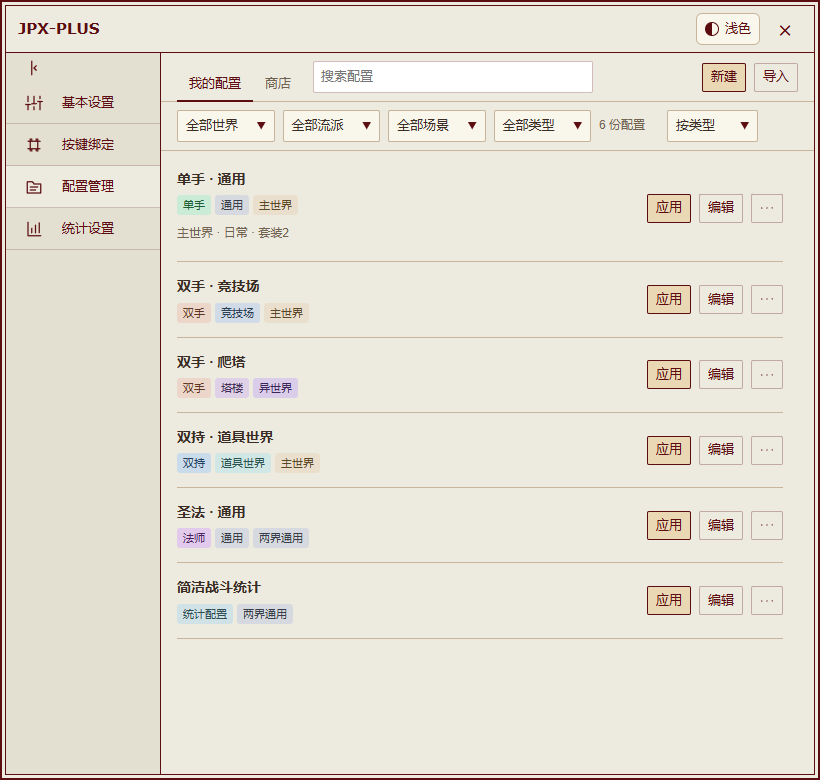</picture></a></td><td valign="top"><a href="https://meiyongai.github.io/JPX-PLUS/?lang=zh-CN&amp;page=rules&amp;device=desktop"><picture><source media="(prefers-color-scheme: dark)" srcset="docs/images/desktop-rules-dark.png">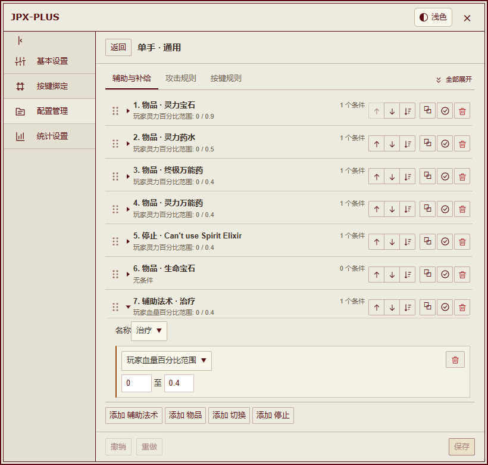</picture></a></td></tr>
</table>

- **套用**會即時使用所選規則。**使用中**標示已套用的設定，**目前流派**則另外標示按裝備識別出的流派。在戰鬥中套用時，自動操作會暫停。
- 編輯頁的**儲存**只會更新已儲存的副本。要讓修改即時生效，請使用**更新並套用**。
- 在**更多**選單綁定套裝，將設定連結至指定世界的人格及裝備套裝。切換至該組合時，便會套用其儲存的規則。同一份設定可綁定多套裝備；未綁定的套裝會沿用目前規則。
- 彩色標籤按設定中的規則群組產生，用來區分流派、世界、戰鬥類型及屬性，淺色及深色主題都有對應配色。可按世界、流派、場景或類型篩選，也能用名稱及標籤搜尋。支援按類型、更新時間、名稱排序，或拖動調整次序。
- **更多 → 刪除**會先顯示哪些地方正在使用這份設定，選擇**清除關聯並刪除**後，清除關聯並刪除已儲存的副本。
- 支援匯入原版 JPX 設定檔。匯出可選擇**目前使用**、**完整設定**或**自選規則**。場景分配保存在 PLUS 設定庫中，不包含於原版 JPX 匯出檔。

套裝綁定與匯出規則

<table>
<tr><th width="50%">套裝綁定</th><th width="50%">匯出規則</th></tr>
<tr><td valign="top"><a href="https://meiyongai.github.io/JPX-PLUS/?lang=zh-CN&amp;page=bindings&amp;device=desktop"><picture><source media="(prefers-color-scheme: dark)" srcset="docs/images/desktop-bindings-dark.png">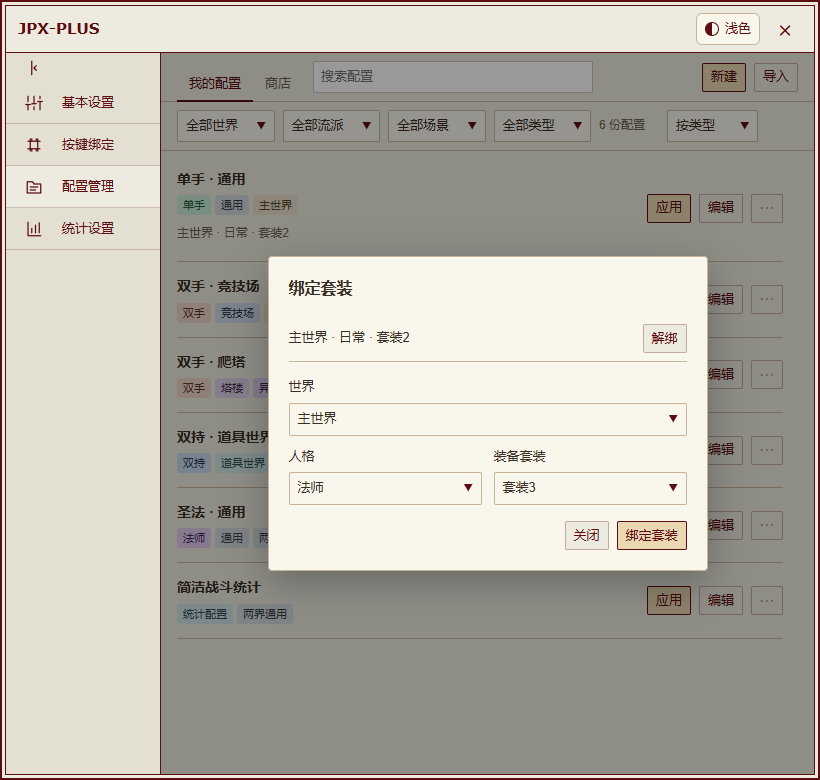</picture></a></td><td valign="top"><a href="https://meiyongai.github.io/JPX-PLUS/?lang=zh-CN&amp;page=export&amp;device=desktop"><picture><source media="(prefers-color-scheme: dark)" srcset="docs/images/desktop-export-dark.png">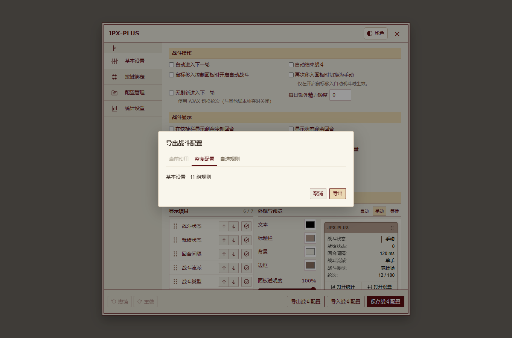</picture></a></td></tr>
</table>

### 商店與分享

毋須登入就能瀏覽及下載。先將商店的設定儲存至**我的設定**，再自行決定何時套用。登入 GitHub 後，可分享已儲存的設定，並在**已分享**中管理。

設定詳情下方可查看留言。登入 GitHub 後可發佈、編輯或刪除自己的留言，刪除前須確認。

支援 1 至 5 星評分，毋須寫留言。每個 GitHub 帳戶對同一份設定只計一票，可改分或撤回。商店顯示平均分與評分人數。

GitHub 登入會自動續期，登出前須再次確認。從舊版更新後可能需要重新登入一次。[登入說明](docs/store-authentication.md#简体中文)。

<table>
<tr><th width="50%">商店</th><th width="50%">已分享的設定</th></tr>
<tr><td valign="top"><a href="https://meiyongai.github.io/JPX-PLUS/?lang=zh-CN&amp;page=store&amp;device=desktop"><picture><source media="(prefers-color-scheme: dark)" srcset="docs/images/desktop-store-dark.png">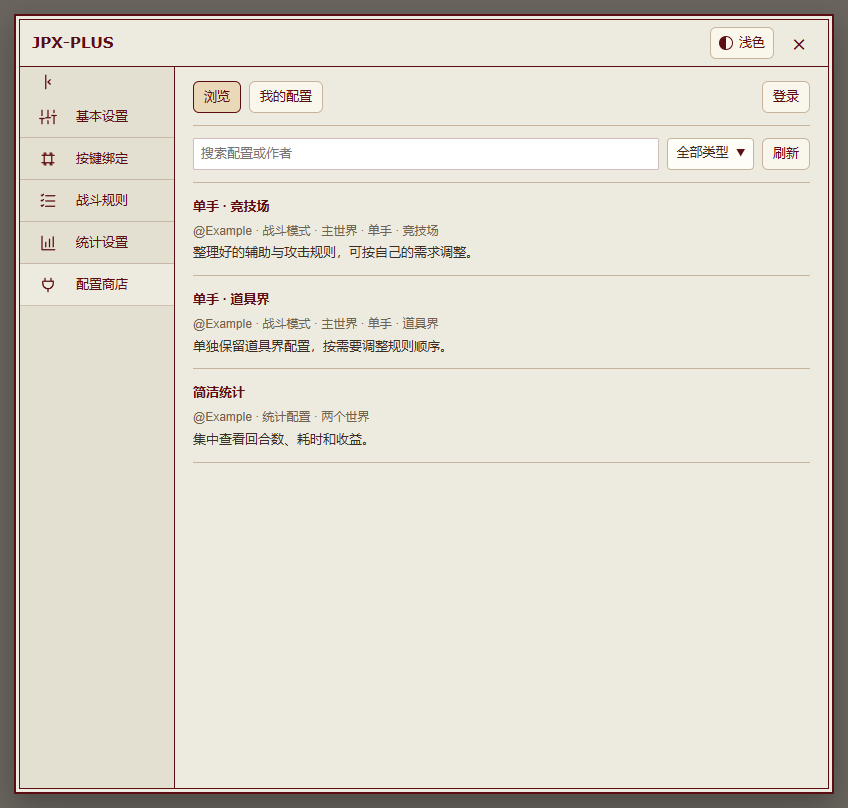</picture></a></td><td valign="top"><a href="https://meiyongai.github.io/JPX-PLUS/?lang=zh-CN&amp;page=shared&amp;device=desktop"><picture><source media="(prefers-color-scheme: dark)" srcset="docs/images/desktop-shared-dark.png">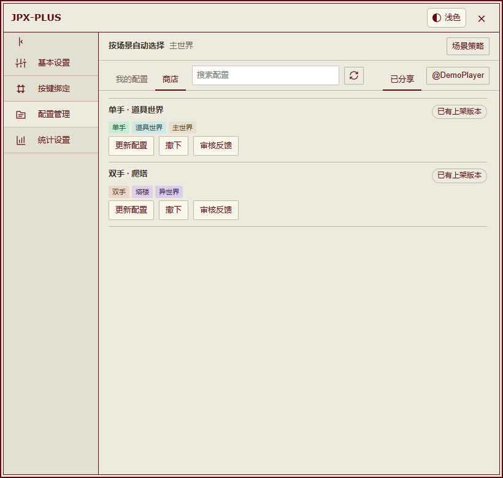</picture></a></td></tr>
</table>

你可以更新同一份分享、查看審核結果、下架，或從自己的清單移除已下架的提交。更新審核期間，上一個通過審核的版本仍可下載。更新分享不會自動取代其他玩家已儲存的副本。

提交的內容會在 GitHub 公開。審核只檢查格式，以及裝置與資料安全，不評價戰鬥策略。程式碼及可疑內容須經 AI 安全審核及維護者批准。[審核政策（英文）](https://github.com/MeiYongAI/JPX-PLUS-Configs#how-sharing-works)。

## 介面預覽

[**淺色主題**](https://meiyongai.github.io/JPX-PLUS/?lang=zh-CN&theme=light&page=configs) · [**深色主題**](https://meiyongai.github.io/JPX-PLUS/?lang=zh-CN&theme=dark&page=configs) · [電腦與手機預覽](https://meiyongai.github.io/JPX-PLUS/?lang=zh-CN&page=configs)

可切換主題、語言及裝置，比較同一頁面的效果。截圖使用實際腳本介面與離線示例資料；截圖及互動預覽目前提供英文、簡體中文介面。

<table>
<tr><th width="50%">我的設定</th><th width="50%">商店</th></tr>
<tr><td valign="top"><a href="https://meiyongai.github.io/JPX-PLUS/?lang=zh-CN&amp;page=configs&amp;device=mobile"><picture><source media="(prefers-color-scheme: dark)" srcset="docs/images/mobile-configs-dark.png">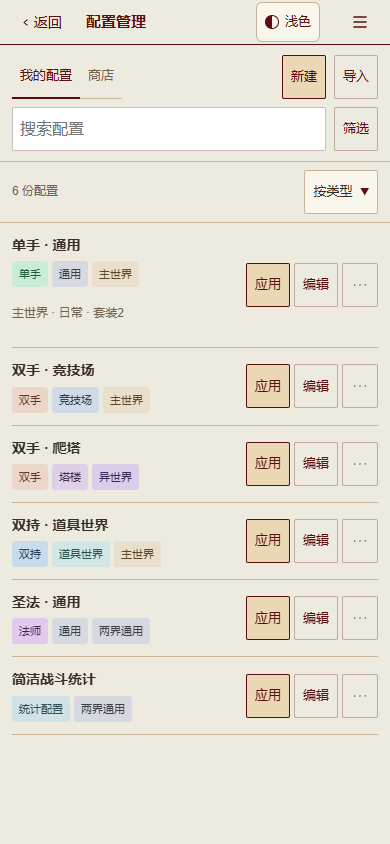</picture></a></td><td valign="top"><a href="https://meiyongai.github.io/JPX-PLUS/?lang=zh-CN&amp;page=store&amp;device=mobile"><picture><source media="(prefers-color-scheme: dark)" srcset="docs/images/mobile-store-dark.png">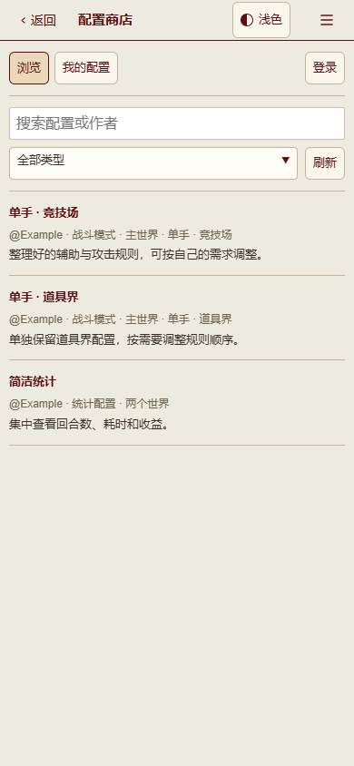</picture></a></td></tr>
</table>

手機版的篩選可在搜尋框旁展開，項目操作保持精簡，設定頁只保留一個返回按鈕。HVUT 齒輪選單內提供設定與統計入口；沒有齒輪選單的觸控頁面，則保留 JPX-PLUS 懸浮入口。

設定、統計與戰鬥結算

<table>
<tr><th width="50%">基本設定</th><th width="50%">統計配色</th></tr>
<tr><td valign="top"><a href="https://meiyongai.github.io/JPX-PLUS/?lang=zh-CN&amp;page=settings&amp;device=desktop"><picture><source media="(prefers-color-scheme: dark)" srcset="docs/images/desktop-settings-dark.png">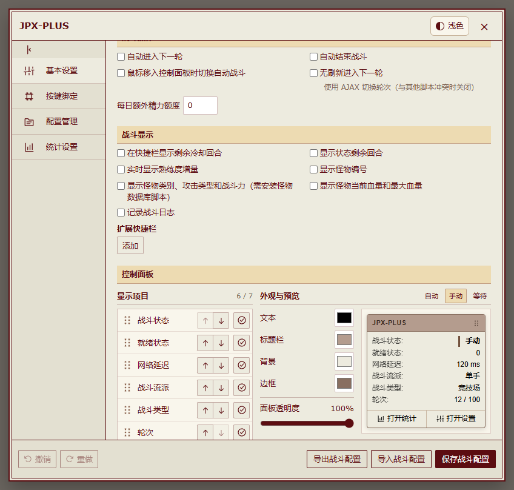</picture></a></td><td valign="top"><a href="https://meiyongai.github.io/JPX-PLUS/?lang=zh-CN&amp;page=colors&amp;device=desktop"><picture><source media="(prefers-color-scheme: dark)" srcset="docs/images/desktop-stats-settings-dark.png">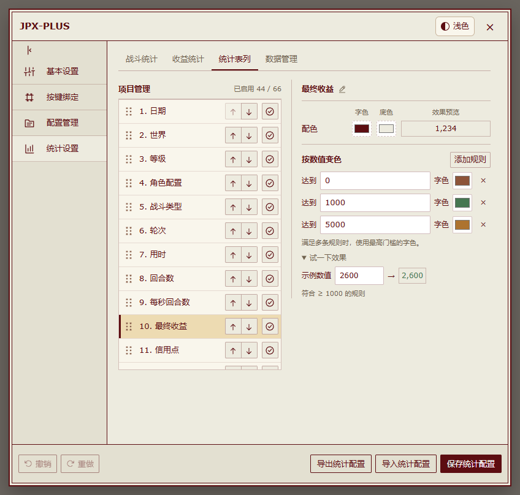</picture></a></td></tr>
</table>

<a href="https://meiyongai.github.io/JPX-PLUS/?lang=zh-CN&amp;page=records&amp;device=desktop"><picture><source media="(prefers-color-scheme: dark)" srcset="docs/images/desktop-records-dark.png">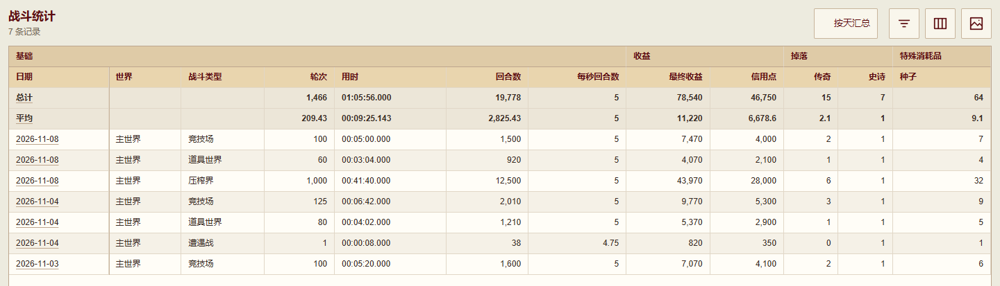</picture></a>

<table>
<tr><th width="50%">戰鬥明細</th><th width="50%">戰鬥結算</th></tr>
<tr><td valign="top"><a href="https://meiyongai.github.io/JPX-PLUS/?lang=zh-CN&amp;page=detail&amp;device=desktop"><picture><source media="(prefers-color-scheme: dark)" srcset="docs/images/desktop-detail-dark.png">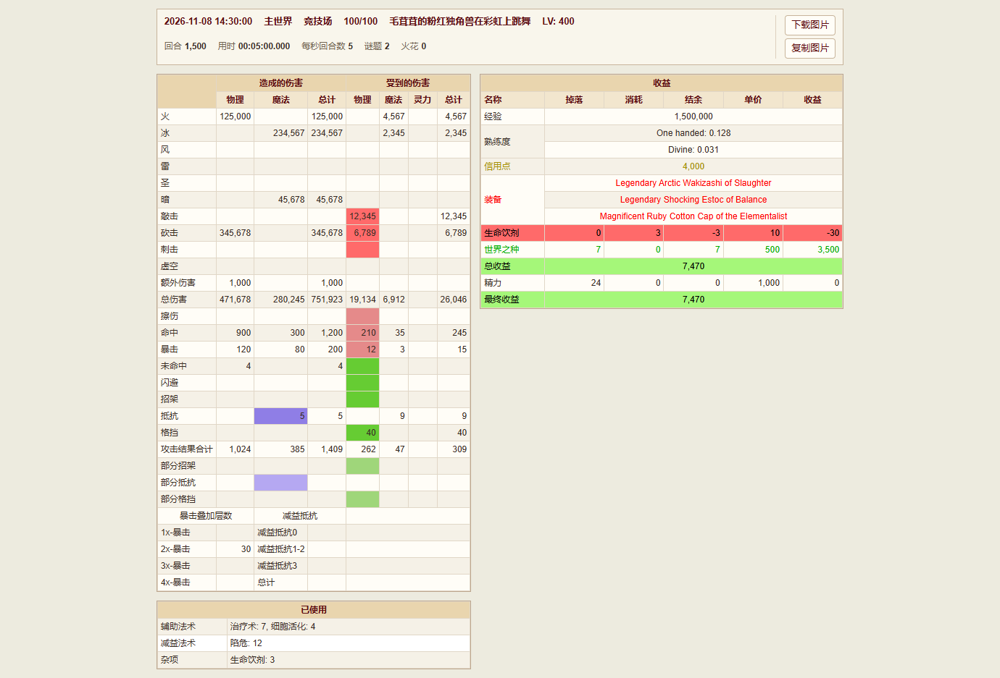</picture></a></td><td valign="top"><a href="https://meiyongai.github.io/JPX-PLUS/?lang=zh-CN&amp;page=final&amp;device=desktop"><picture><source media="(prefers-color-scheme: dark)" srcset="docs/images/desktop-final-dark.png">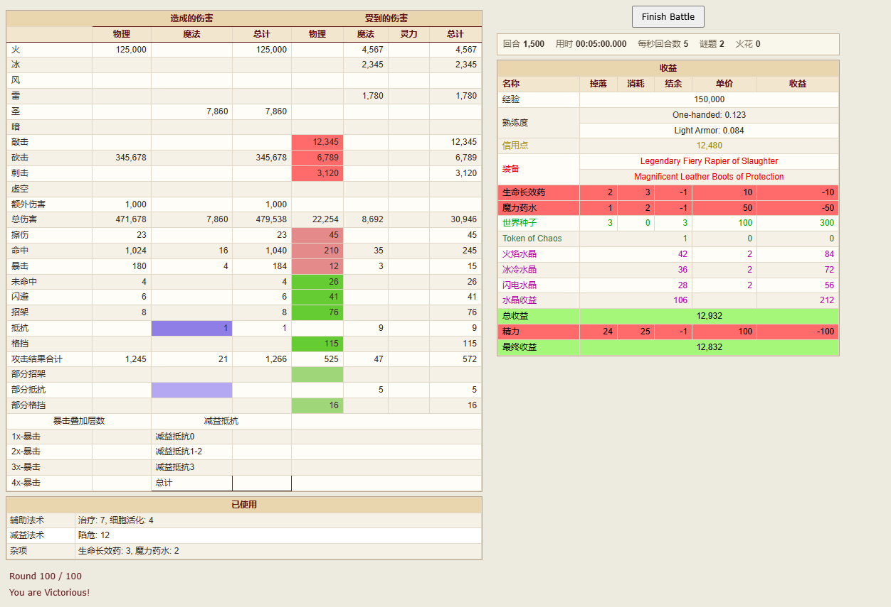</picture></a></td></tr>
</table>

<a href="https://meiyongai.github.io/JPX-PLUS/?lang=zh-CN&amp;page=panel&amp;device=desktop"><picture><source media="(prefers-color-scheme: dark)" srcset="docs/images/control-panel-dark.png">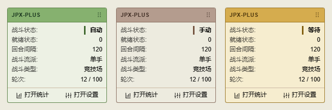</picture></a>

## 戰鬥統計與操作

- 篩選紀錄、查看單場戰鬥明細，並將統計複製或下載為圖片。
- 紀錄頁頂欄提供按日彙總、篩選、顯示項目、圖片及清理入口。
- 顯示項目按分類選擇，變更會自動儲存並由主站與 alt 共用；保留自訂名稱、顏色及次序。
- 統計頁的資料管理集中提供匯入、匯出、還原及範圍清理；刪除前須確認。
- 自訂可拖動控制面板及統計配色，支援即時預覽與淺色、深色主題。
- 編輯戰鬥規則、條件及快捷鍵，支援復原與重做。

| 預設快捷鍵 | 功能 |
| --- | --- |
| <kbd>M</kbd> | 開始或暫停自動戰鬥操作 |
| <kbd>,</kbd> | 開啟設定 |
| <kbd>Z</kbd> | 開啟戰鬥統計 |

已同步原作者於 2026 年 11 月 5 日新增的雙手預設規則。現有設定不會被覆寫；如要載入預設規則，請在規則編輯頁開啟雙手設定，使用**重設規則**。儲存副本不等於套用，仍須自行套用。原版為 300 級以下角色啟用的安全模式，也不保證不會戰敗。

預設會保留戰鬥結算頁。啟用**基本設定 → 戰鬥操作 → 自動結束戰鬥**後，會先儲存統計，再自動按遊戲的離開按鈕，不會開始下一場戰鬥。如儲存失敗，會保留結算頁。

不包含自動開戰、每日簽到及大廳任務排程。如其他腳本在 AJAX 換輪後停止運作，可到基本設定關閉此選項；AJAX 換輪不會重新載入其他用戶腳本。

## 搭配使用

| 附加工具 | 安裝 | 討論 |
| --- | --- | --- |
| HentaiVerse 深色主題 · Stylus | [UserCSS](https://raw.githubusercontent.com/MeiYongAI/JPX-PLUS/main/HV-Dark.user.css) | [論壇](https://forums.e-hentai.org/index.php?showtopic=302930) |
| E-Hentai 論壇深色主題 · Stylus | [UserCSS](https://raw.githubusercontent.com/MeiYongAI/JPX-PLUS/main/E-Hentai-Forums-Dark.user.css) | [論壇](https://forums.e-hentai.org/index.php?showtopic=302931) |
| HentaiVerse 中文翻譯 | [用戶腳本](https://raw.githubusercontent.com/MeiYongAI/JPX-PLUS/main/HentaiVerse-Chinese.user.js) | [中文討論帖](https://forums.e-hentai.org/index.php?showtopic=302932) |

以上工具均需另外安裝。遊戲中文翻譯與 JPX-PLUS 語言包是不同的腳本。[截圖、安裝方式與致謝（簡體中文）](docs/addons.zh-CN.md)。

## 問題回報與開發

[Issues](https://github.com/MeiYongAI/JPX-PLUS/issues) 接受英文或中文回報。請附上腳本版本、瀏覽器、所在世界及重現步驟，並先移除截圖及匯出設定中的私人資料。

開發相關請看[原始碼、建置及離線測試（英文）](docs/development.md)。安裝後仍是單一、可獨立運作的用戶腳本；遊戲中不會載入開發模組或測試套件。
