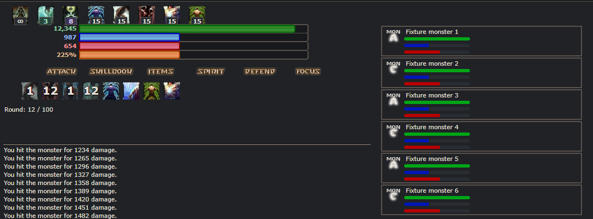
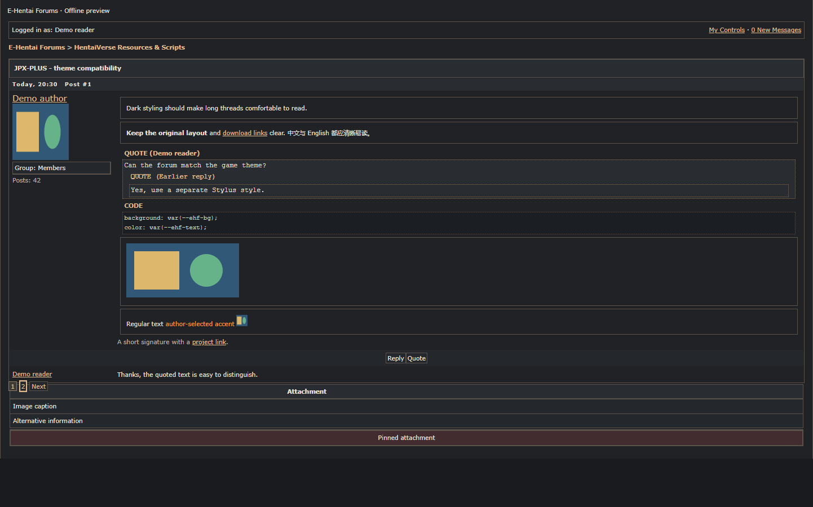
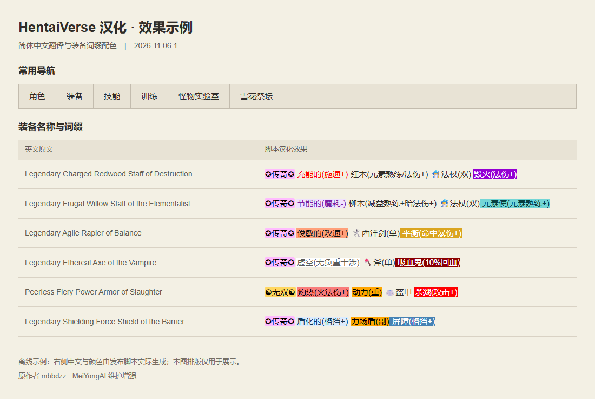

# Companion scripts and themes

[Back to JPX-PLUS](../README.md) · [中文](addons.zh-CN.md)

| Add-on | Install | Forum |
| --- | --- | --- |
| HentaiVerse Dark (Stylus) | [UserCSS](https://raw.githubusercontent.com/MeiYongAI/JPX-PLUS/main/HV-Dark.user.css) | [Thread](https://forums.e-hentai.org/index.php?showtopic=302930) |
| E-Hentai Forums Dark (Stylus) | [UserCSS](https://raw.githubusercontent.com/MeiYongAI/JPX-PLUS/main/E-Hentai-Forums-Dark.user.css) | [Thread](https://forums.e-hentai.org/index.php?showtopic=302931) |
| HentaiVerse Chinese translation | [Userscript](https://raw.githubusercontent.com/MeiYongAI/JPX-PLUS/main/HentaiVerse-Chinese.user.js) | [中文帖](https://forums.e-hentai.org/index.php?showtopic=302932) |

HentaiVerse Dark is a separate UserCSS theme for the game and HVUT, not a userscript. Install [Stylus](https://add0n.com/stylus.html), then open the theme link above and install it from the raw UserCSS file, or copy the file into a new UserCSS style. The theme includes an update URL; update checks depend on your Stylus settings. The JPX-PLUS interface retains its own light/dark setting. The theme is experimental; first-paint timing varies by browser and Stylus settings.

**HentaiVerse Dark 1.0.6** makes JPX quickbar cooldown numbers readable with light text and a subtle dark outline, including extended skill slots. It also supports HV Paper Doll equipment windows, menus and battle portrait controls, plus the My Little Pony helper panel and sliders. Character artwork, custom backgrounds, color previews and puzzle-image effects are preserved.

**E-Hentai Forums Dark** is a separate Stylus theme for `forums.e-hentai.org`, using the same palette. It covers forum lists, threads, quotes, code blocks, reply editors, menus and native image buttons, while preserving avatars, emoji, posted images and author-selected text colors. Install it from the link above; it includes a GitHub update URL. Checked against the Ambience skin, including the full reply editor; Fusion has not been specifically tested. The forum's existing narrow-screen layout is preserved.

Dark theme previews: game and forum

**HentaiVerse Dark — battle, cooldowns and effect timers**

**E-Hentai Forums Dark — posts, quotes and code blocks**

Offline previews using the sites' native styles and sample content.

The optional **HentaiVerse game translation** translates game text and adds equipment-affix colors, including supported auction listings. It is separate from the JPX-PLUS language packs and can run without JPX-PLUS. Thanks to **mbbdzz**, its original author ([source](https://greasyfork.org/scripts/600755)); this edition is maintained and enhanced by **MeiYongAI**, retaining its MIT license declaration. Install the script above and refresh the game. GitHub update URLs are included for userscript-manager update checks.

Game translation and equipment color preview

Offline sample rendered with the released translation script; the comparison layout is for illustration.

