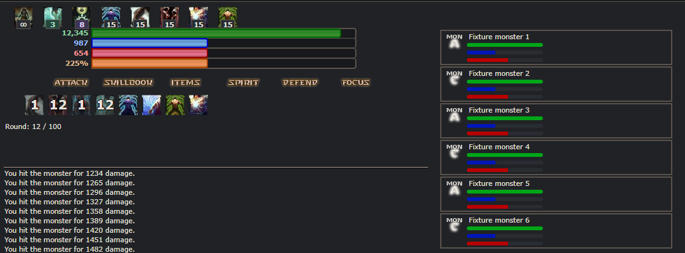
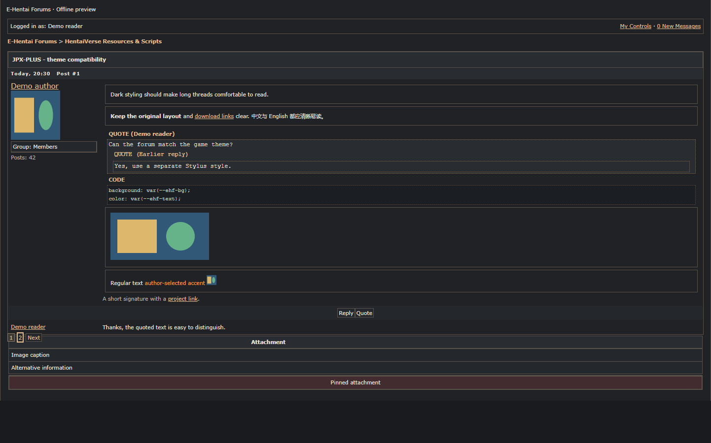
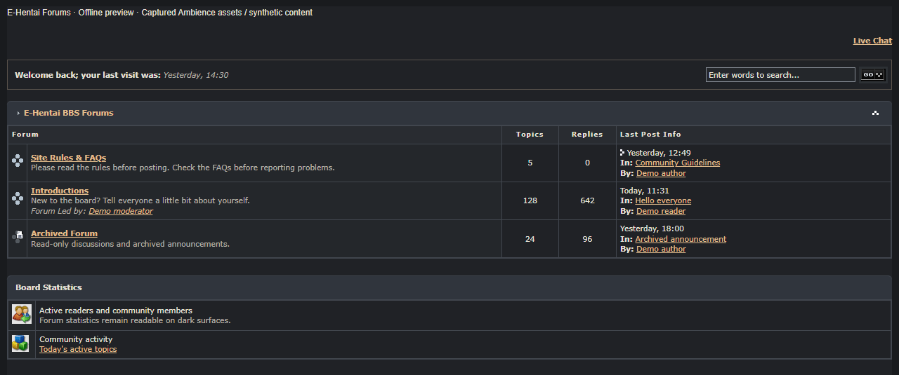
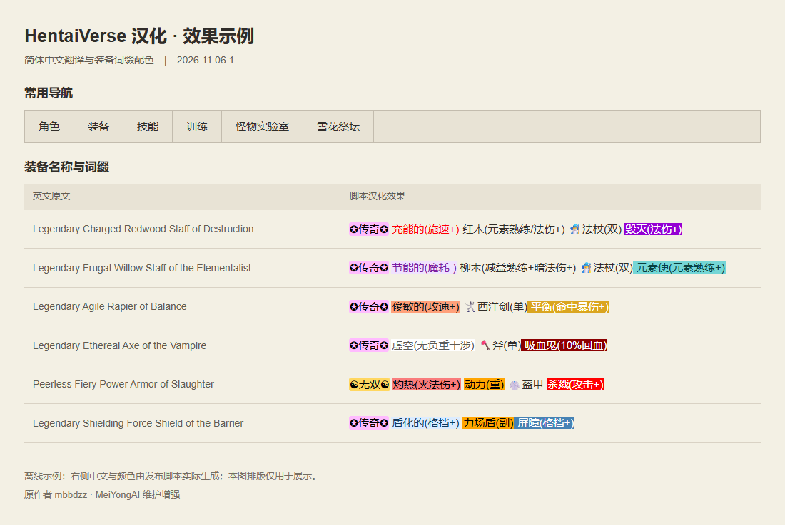

# 配套脚本与主题

[返回 JPX-PLUS](../README.zh-CN.md) · [English](addons.md)

| 项目 | 安装 | 论坛 |
| --- | --- | --- |
| HentaiVerse 暗色主题 | [UserCSS](https://raw.githubusercontent.com/MeiYongAI/JPX-PLUS/main/HV-Dark.user.css) | [发布帖](https://forums.e-hentai.org/index.php?showtopic=302930) |
| E-Hentai 论坛暗色主题 | [UserCSS](https://raw.githubusercontent.com/MeiYongAI/JPX-PLUS/main/E-Hentai-Forums-Dark.user.css) | [发布帖](https://forums.e-hentai.org/index.php?showtopic=302931) |
| HentaiVerse 汉化 | [用户脚本](https://raw.githubusercontent.com/MeiYongAI/JPX-PLUS/main/HentaiVerse-Chinese.user.js) | [发布帖](https://forums.e-hentai.org/index.php?showtopic=302932) |

## 暗色主题

先安装 [Stylus](https://add0n.com/stylus.html)，再打开表中的 UserCSS 链接安装主题。两个主题都带有 GitHub 更新地址，自动检查更新取决于 Stylus 设置；JPX-PLUS 窗口仍使用自己的浅色／暗色开关。

**HentaiVerse Dark** 覆盖游戏与 HVUT 界面，适配快捷栏冷却数字、扩展技能槽、纸娃娃窗口及小马助手面板。保留角色立绘、自定义背景、配色预览和谜题图片效果。首次绘制效果仍取决于浏览器和 Stylus 设置。

**E-Hentai Forums Dark 1.1.0** 覆盖论坛列表、帖子、引用、代码块、编辑器、菜单与图片按钮，保留头像、表情、帖子图片和作者设置的文字颜色。

1.1.0 修复图片搜索按钮白底，优化分类标题和分隔线，补齐深色状态图标、附件与引用返回箭头，保留已读／未读等状态差异。700px 以下首页搜索栏分行，分类表格在自身区域内横向滚动；帖子和编辑器布局保持不变。已通过 32 组页面离线检查，以及 28 种原生图片的双加载顺序检查，另验证 56 个正文／签名图像副本保持不变。检查使用真实 Ambience 素材与合成内容，不代表已完成实际 Stylus 安装后的验证；Fusion 尚未专门验证。

查看游戏与论坛暗色预览

**HentaiVerse：战斗界面与冷却数字**

**E-Hentai 论坛：帖子、引用与代码块**

**E-Hentai 论坛 1.1.0：首页、搜索与状态图标**

预览使用网站原生样式与示例内容离线渲染。

## 游戏汉化

翻译游戏文本并为装备词缀染色，也支持已适配的拍卖网站列表。它与 JPX-PLUS 语言包分别安装，可以独立使用。安装后刷新游戏页面即可；脚本带有 GitHub 更新地址，可由脚本管理器检查更新。

特别感谢原作者 **mbbdzz**（[原版页面](https://greasyfork.org/scripts/600755)）；此版由 **MeiYongAI** 维护和增强，保留原有 MIT 许可声明。

查看汉化与装备染色预览

使用发布脚本离线渲染的示例；对照布局仅用于展示。

