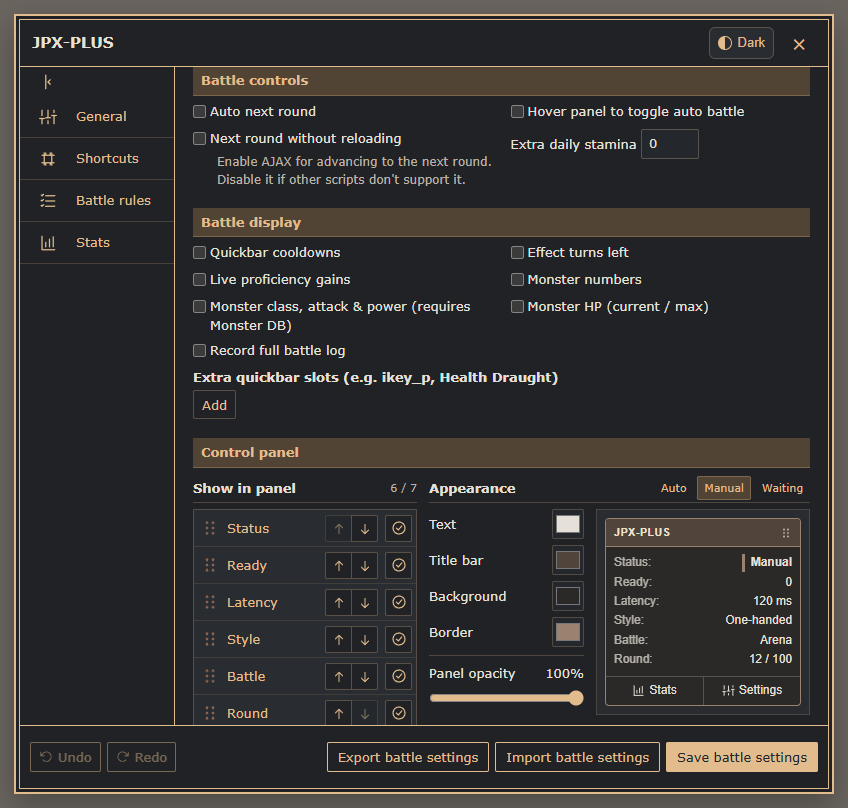
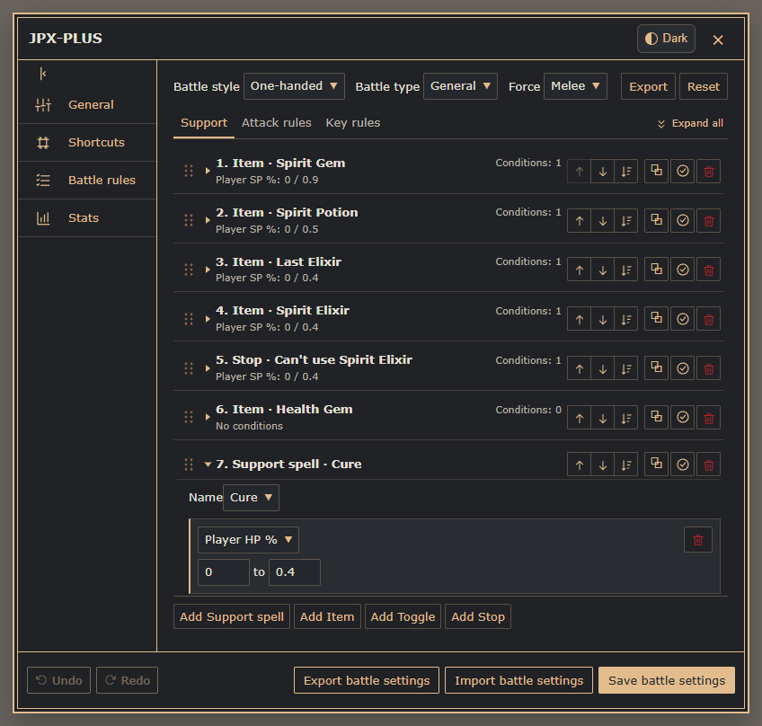
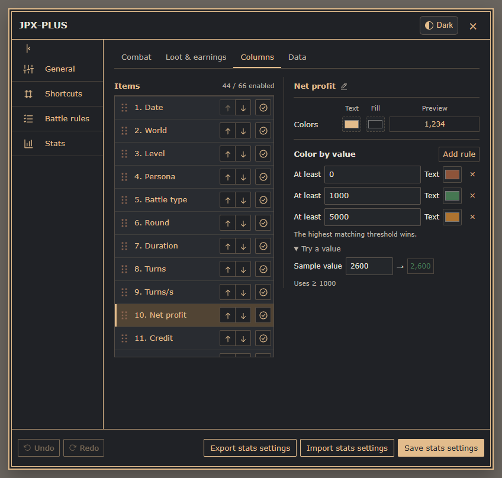
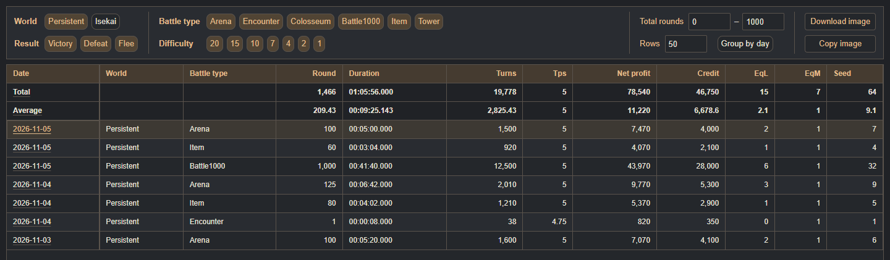
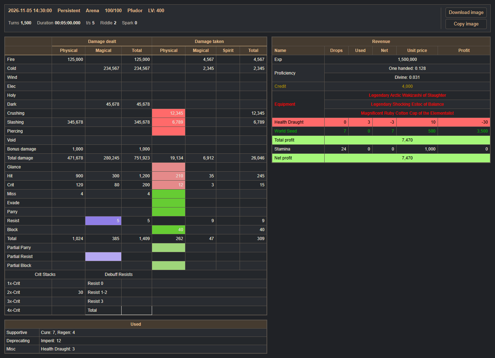
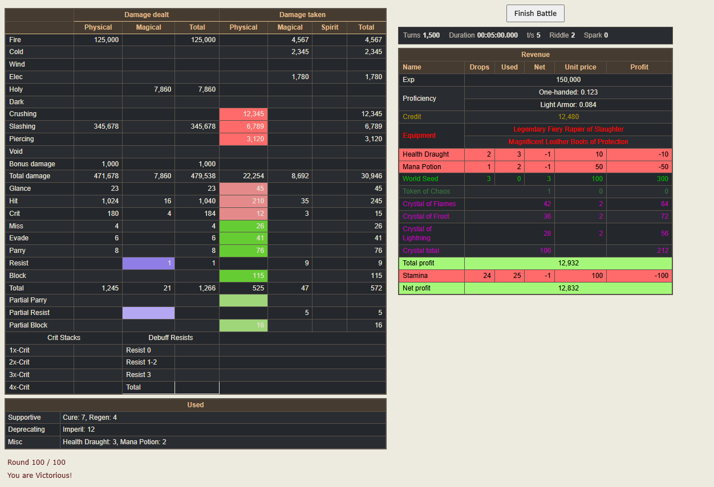
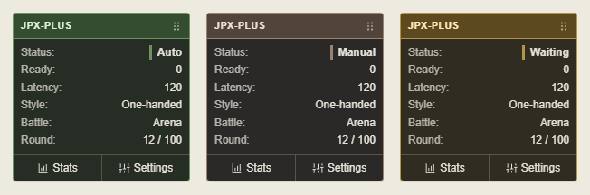
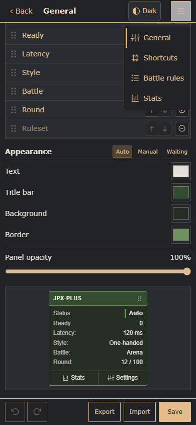
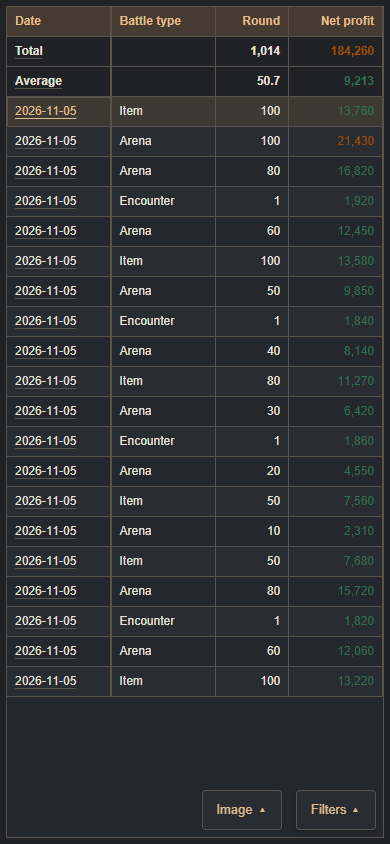
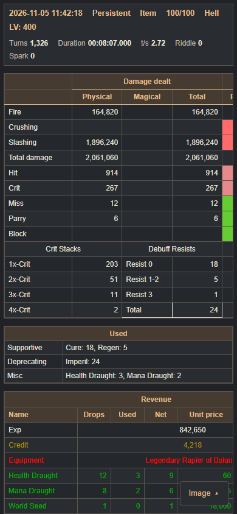

# JPX-PLUS · Dark Theme

[English](gallery-dark.md) · [简体中文](gallery-dark.zh-CN.md)

[Back to README](../README.md) · [Switch to light theme](gallery-light.md) · [Open interactive preview](https://meiyongai.github.io/JPX-PLUS/?theme=dark&lang=en)

Actual script interfaces with offline sample data and demonstration settings. Click an image to view it at full size.

## Desktop Settings

<table>
<tr><th width="50%">Basic settings</th><th width="50%">Battle rules</th></tr>
<tr><td valign="top"></td><td valign="top"></td></tr>
</table>

## Battle statistics

<table>
<tr><th width="50%">Historical battle details</th><th width="50%">Battle results</th></tr>
<tr><td valign="top"></td><td valign="top"></td></tr>
</table>

## Floating control panel

Default control-panel colors follow the theme; custom colors are preserved.

## Mobile

<table>
<tr><th width="33%">Settings and navigation</th><th width="33%">Battle statistics</th><th width="33%">Single-battle details</th></tr>
<tr><td valign="top"></td><td valign="top"></td><td valign="top"></td></tr>
</table>
